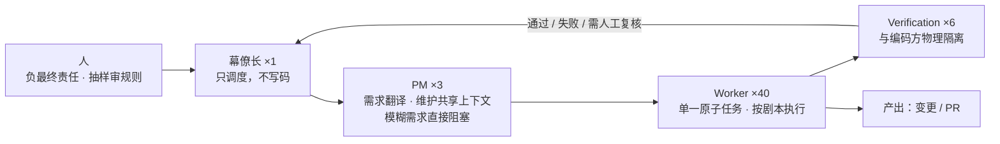
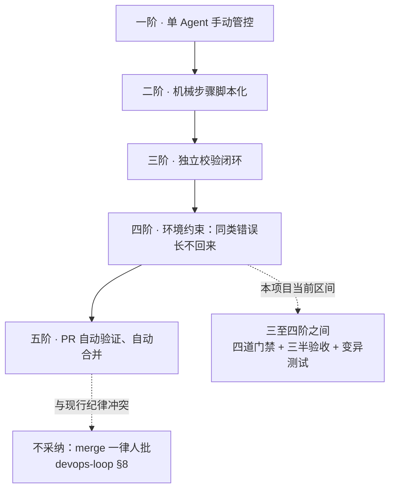
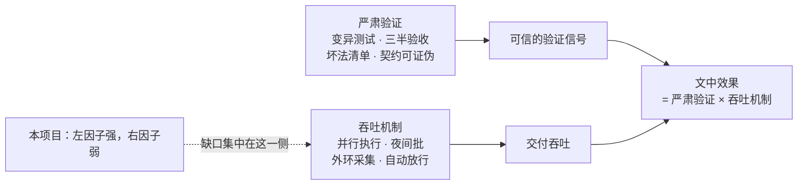

# 「多 Agent 厨房」方法论 vs. mini-harness 现行机制：差距分析与落地建议

**日期**：2026-11-18　**性质**：一次性分析，不进读量清单，不修改任何流程文档　**产出目的**：为人裁提供输入

**资料来源**：① 公众号文章《一个人顶20人工程师团队：SpaceX女工程师的50+ Bot军团，月交付1000个PR的完整方法论》（下称「文中」，为二手整理稿，整理自 Matt Pocock 对 Lauren Tan 的访谈直播，本报告未对照原始访谈，凡转述均以「文中称」标注）；② 本仓库 `AGENTS.md`、`docs/process/devops-loop.md`、`docs/CURRENT.md`、`docs/roadmap.md`、`docs/lessons.md`、`docs/plan-2026-W47.md`。

**分区规则**：第 1–3 节为可验证事实（文中说了什么 / 仓库里有什么）；第 4–6 节为建议与推测，全部标注【建议·待人裁】或【推测】，最终取舍由人裁决。

**图索引**：图 1 四角色厨房与隔离验证（§1.1）· 图 2 五阶信任阶梯与本项目位置（§1.2）· 图 3 「严肃验证 × 吞吐机制」两因子（§3）。

---

## 1. 文中方法论的机制拆解（事实：文中描述了什么）

按文中整理稿，该体系共九个可分离的机制。以下全部是对该文的归纳转述，不代表对其真实性背书。

1. **四角色组织（「米其林厨房」）**。1 个幕僚长（只调度不写码）、3 个 PM（需求翻译、维护共享上下文、模糊需求直接阻塞）、40+ Worker（只做单一原子任务、按剧本执行）、6 个 Verification（与编码方物理隔离，只认客观运行证据，判定只有「通过／失败／需人工复核」三种）。文中强调 50 是资源池总量而非并发数（老王，「二、对话实录」节）。
2. **信任阶梯（五阶）**。从「单 Agent 手动管控」逐级升到「PR 自动验证、自动合并」；文中第一公理为「Verification is all you need」，即对 AI 的信任必须靠可复现的客观证据逐级累积，不靠感觉（老王，「二」节第 3 小节）。
3. **双循环**。外环自动监听工单/反馈并补全上下文，内环完成拆解→下发→编码→独立校验→合并的交付闭环，支撑夜间批量异步、白天抽样验收（老王，「二」节第 4 小节）。
4. **园丁机制**。每发现一个重复错误，不只修当次产出，而是改造环境——新增 Lint 规则、类型约束、自动化校验，使同类错误不能再发生（「每除掉一根杂草，就新增一条规则」）（老王，「二」节第 5 小节）。
5. **Feature Map 共享上下文**。一份结构化文档承载目标、接口清单、数据模型、验收标准、已知坑与变更日志，作为所有 Bot 的决策基准，且优先级高于模型固有知识（老王，「四」节第 6 小节）。
6. **Playbook 与不可跳过的 Todo**。任务匹配固定剧本，清单逐条执行；要跳步必须写明理由，禁止静默跳过（老王，「四」节第 1、4 小节）。
7. **任务原子化与歧义阻塞**。大需求拆成可独立验证的小任务；需求模糊时阻塞上报、禁止脑补（老王，「四」节第 1、3、4 小节）。
8. **风控边界**。校验与编码必须独立、高风险不可逆业务禁自动合并、并发受算力与 CI 约束、固定流程下沉为脚本、人负最终责任（抽样审规则而非逐行审代码）（老王，「三」节第 5 小节）。
9. **角色 System Prompt 化**。四个角色各有固定职责、输出规范与禁止行为清单，配全局铁律底座（老王，「四」节第 1–5 小节）。

九个机制里有两处最容易在转述中走形，单独画出来：组织形状（谁是执行体、谁只判定）与信任阶梯（凭什么往上走）。

### 1.1 四角色与「物理隔离的验证」

**图 1**：数字不必记——要记的是三件事：调度者不写码、Worker 按剧本做原子任务、判定者与执行者物理隔离且只认运行证据。50+ 是资源池总量，不是并发数。

### 1.2 五阶信任阶梯

**图 2**：阶梯的通行证是「可复现的客观证据」，不是感觉。本项目卡在三到四阶之间，缺的不是验证手段，而是「谁来跑验证」的独立执行体；第五阶被 `devops-loop.md` §8 明文禁止，采纳与否见本文 §6 冲突清单第 1 条。

---

## 2. 本项目现状盘点（事实：仓库里有什么）

### 2.1 开发流程层

- **角色矩阵已具雏形**：构建 = 主 agent；验证 = CI + 测试 + 真实端点（独立进程/机器）；审查 = harness 子代理（只读、不共享上下文）；裁决 = 人（`devops-loop.md` §7.2）。
- **三道独立检查已制度化**：写代码前的契约与对齐复核（子代理六项检查 + DSH 十项）、实现后的对照门禁（子代理拿 diff 逐条映射证据）、四道门禁 + 真实端点 + UAT（`devops-loop.md` §0.4）。
- **三半完成判据**：mock（四道门禁）/ 真实端点 / UAT 人跑，三半全过才可归档合入；UAT 表没填完不得归档（ADR-0024、ADR-0025；`AGENTS.md`「完成判据」）。
- **变异测试 + Learning Gate**：每 change 收尾跑一轮变异并记录存活变异；Learning Gate 把可复用教训写进 `docs/lessons.md`，晋升 AGENTS.md 时执行「一进一出」（`AGENTS.md`「流程」节）。
- **机械步骤脚本化**：`scripts/gates.sh`、`coverage-report.sh`、`new-change.sh`、`check-change.sh`、`pre-commit.sh`、`harness_hooks.py`；「硬兜底：机械步骤一律脚本化，由 git hook / harness hook / CI 执行，不靠记性」（`devops-loop.md` §0.6 第 7 条）。
- **停点与升级纪律**：人只在五类停点被询问；六类情形升级人裁；merge `main`、改 AGENTS/ADR/流程一律人批（`devops-loop.md` §0.1、§1.1）。
- **定时 loop 只有设计未上线**：L0 每日观察、L1 每周经验两条「日程要人确认后才建」（`devops-loop.md` §6）。
- **明确不做**：常驻 agent 跑 UAT、全自动 merge 与自动改 AGENTS.md（`devops-loop.md` §8）。

### 2.2 产品机制层（harness 自身，即「机器人军团」的运行底座）

- **委派（M12，已合入）**：`subagent` 工具、独立子日志、深度/容量上限（`maxActiveSubagents` 8）、子级不继承 approval 放行、并行 `parallel` 类别。
- **子代理 preset（已合入）**：`[subagent]` preset + 白名单决定子工具表；persona 字段由 M14 补。
- **目标轮次（M13，进行中）**：持久 goal、轮次续跑、`blocked` 门槛（同一阻碍持续三轮）、todo 并行纪律——对应「长任务不靠人反复续跑」。
- **技能与命令（M14，已合入）**：SKILL.md 六级根、清单注入 + 正文按需、CLI 与 host 同一命令面。
- **个人助理 UX（M14c，已完成）**：`todo` / `plan` / `ask_user` / `present`——对应「不可跳过的 Todo 清单」与「产物交付」。
- **记忆（MEM1，待做）**：项目/用户 `MEMORY.md` + `memory` 工具 + `memory/loaded` 事件——对应 Feature Map 类共享上下文。
- **E2 组件接缝（待做）**：首批组件含 `Verifier`、`SubagentPolicy`、`ApprovalGate`——即「校验 Bot」的产品化位置（`roadmap.md` E2 节）。
- **无人值守入口条件已写死**：H1/H2/M11/M14/MEM1/M15a 全部完成才允许 `approval: auto`，且禁 `danger-full-access`（`roadmap.md`「第三阶段入口条件」）。

### 2.3 已知缺口（事实，来自 `docs/CURRENT.md`）

1. 覆盖率读数对不上：`tools/goal.py` 单跑 94%、全量聚合掉到 34%，`coverage combine` 的 partial 合并行为异常，结论「先不当绿，也不要报数」；下一步计划改为「不开 parallel、单文件 append」。
2. `scripts/gates.sh` 因沙箱删除额度拆成两条命令。
3. P0 预算读数缺陷未复现；`SESSION_BUSY` 状态码自相矛盾；委派三处语义原语未对齐。

---

## 3. 逐项差距映射（事实对照）

| 文中机制 | 本项目对应 | 差距 | 说明 |
|---|---|---|---|
| ① 四角色组织 | 角色矩阵 + 三道独立检查 | **中** | 审查已隔离；「验证」仍由实施 agent 自己跑命令，不是独立执行体；无常驻调度（幕僚长）与需求翻译（PM）专职 |
| ② 信任阶梯五阶 | 三半验收 + 变异 + 门禁 | **中** | 处于三至四阶（有校验闭环 + 环境约束）；第五阶「自动合并」被纪律明文禁止 |
| ③ 双循环 | 内环完整；外环未上线 | **大** | L0/L1 只有设计；无自动需求采集；无夜间批量验收 |
| ④ 园丁改土壤 | Learning Gate + 一进一出 + 变异 | **小** | 「教训 → 文本规则」通畅，「教训 → 机器强制规则」的转化路径不显式 |
| ⑤ Feature Map | AGENTS.md + CURRENT + specs 分散 | **中** | 真源规则清楚，但缺「一页结构化现况」；specs 按 change 累积，无派生的接口/词表清单 |
| ⑥ Playbook + Todo | tasks.md + §0.6 推进模式 + M14c todo/plan | **小** | 流程单剧本；按 change 类型的复用剧本（bugfix/新工具/规格修正）没有模板 |
| ⑦ 原子化 + 歧义阻塞 | 切片纪律 + 六类升级 + 六问 | **无** | 该项已充分对齐，甚至更严 |
| ⑧ 风控边界 | 独立校验/人批 merge/UAT 人跑/脚本化 | **小** | 项目在「人负最终责任」上比文中更保守；唯一冲突点是自动合并 |
| ⑨ 角色 Prompt 化 | 子代理复核输入契约 + preset persona | **中** | 流程侧子代理有输入契约但无角色化 prompt 库；产品侧 persona 待补全 |

**总体判断**：本项目在「验证的严肃性」（变异测试、三半验收、坏法清单、契约可证伪）上显著强于文中描述；在「吞吐量机制」（并行执行、夜间批、外环采集、自动放行）上显著弱于文中描述。文中效果 = 严肃验证 × 吞吐机制，本项目缺的主要是后一个因子。

**图 3**：两因子是乘法不是加法——验证再严也只保证信号可信，不会自己产生吞吐。文中效果落在右上，本项目在左上；§4 的排序因此是「先把信号修可信（P0-1），再补右因子（P0-2 / P0-3）」。

---

## 4. 落地做法（建议·待人裁，按优先级排列）

### 4.1 P0：不动任何现行纪律即可推进（3 项）

**P0-1 修复覆盖率合并接线（并行与夜间批的前置）**
- 做法：按 `CURRENT.md` 既定方向，把子进程覆盖率从「parallel partial + combine」改为「不开 parallel、单文件 append」，消灭 partial 与合并；修完后全量聚合读数与单文件读数必须同向（并集不小于任一份）。
- 判据：`tools/goal.py` 单跑与全量聚合的覆盖率差值 ≤2 个百分点；`coverage report` 不再报 skipped partial。
- 关键点：这是本仓库当前唯一「读数不可信」的门禁环节；读数不可信时一切自动放行都无从谈起。
- 风险点：`coverage erase`/删除行为受沙箱删除额度约束，脚本要保持「零删除」或改走受控清理；改动涉及 `gates.sh` 与 `coverage-report.sh` 的分工，勿顺手重构其余脚本（编码行为四规第 3 条）。

**P0-2 启动 L0 每日观察定时任务（外环最小雏形）**
- 做法：按 `devops-loop.md` §6 的既有设计建每日 09:00 定时任务：扫活动 change 未勾 task、最近 CI 结论、分支落后提交数，输出 ≤10 行摘要；明确不改代码、不提交、不合并。日程（09:00，Asia/Shanghai）需人确认后创建。
- 判据：连续 5 个工作日产出摘要；分诊为空时只输出一行「无新事项；下一里程碑：X」。
- 关键点：该设计已写进流程文档，落地零新增规则；它是文中「外环信息采集」的第一步。
- 风险点：定时任务噪声（分诊不准会稀释注意力）；若把「分诊」误做成「自动 propose」就越过现行纪律（「分诊不是 propose」）。

**P0-3 建「夜间验收批」脚本（只跑已有门禁，不新增裁决）**
- 做法：新增 `scripts/night-verify.sh`（名字待定）：对指定 `change/<id>` 分支在干净 worktree（`git worktree add`）里跑四道门禁 + 变异测试清单，产出 `docs/verification/<id>-night-<date>.log` 报告；**不跑 UAT、不做 merge、不跑花钱的真实端点**（或真实端点需人单次授权并给预算上限）。配合定时任务在夜间执行，白天人只读报告。
- 判据：对当前 `change/m13-goal-rounds` 跑一遍，报告含四道命令退出码与实测数字，且主工作区 `git status` 不被污染。
- 关键点：这直接复现文中「一觉醒来验证已完成」的体验，且完全落在现行纪律内（验证是自动的，裁决仍归人）。
- 风险点：worktree 与 uv 环境的重复安装成本；沙箱删除额度对 `coverage erase` 的拦截要在脚本内显式处理；夜间真实端点调用有费用与密钥暴露面，默认关闭。

### 4.2 P1：需要人裁的一处规则升级（3 项，各自独立裁决）

**P1-1 验证执行独立化（把「验证」角色做实）**
- 做法：把三半验收中「四道门禁 + 真实端点」的**执行者**从实施 agent 换成独立上下文子代理（WorkBuddy 的只读/受限子代理，不是 mini 自己的 `subagent`——后者是被测对象）；输入只有分支名 + 验证契约路径 + 四道命令，输出 PASS/FAIL + 原始日志摘录；实施 agent 的自述不作为证据。对应文中「校验 Bot 与编码 Bot 物理隔离，不信任任何口头承诺」。
- 判据：一份抽样报告中，验证会话输出的测试数字与独立复跑一致；验证会话未写入任何工作区文件。
- 关键点：`devops-loop.md` §7.2 角色矩阵的「验证」列已是「独立进程」语义，此项是把「谁来跑」补严，改动面小。
- 风险点：验证子代理跑命令需要执行权限（非只读），与 §4「子代理只读」条款冲突，需明确「验证子代理可执行只读命令与测试命令、禁止写文件」；token 成本约翻倍；流程文档净增 ≤0 的约束下，这段规则要挤进现有条目或人裁豁免。

**P1-2 分级放行（用「低风险自动合并」替代全面自动合并）**
- 做法：不采纳文中「自动合并」全量形态，改为分级：仅当 change 满足「不触碰 A–F 不变量、不含安全面/规格语义变更、四道门禁绿、对照门禁 PASS、变异全杀」时，允许**自动合入 `main`**；其余（含 UAT 场次）保留人批。高风险清单白纸黑字列在验证契约里。这对应文中自己的风控条款「高风险业务关闭自动合并」。
- 判据：连续 10 个低风险 change 自动合入零回滚；任何一个触发回滚的 case 都回写为新的「高风险」分类条件（园丁机制）。
- 关键点：文中第五阶信任的本质是「验证体系可信到可以放行」，分级放行保留这个本质又守住 ADR-0025 边界。
- 风险点：**直接违反 `devops-loop.md` §8「全自动 merge」的明文禁止**，必须人裁修改该条并留 ADR（难回退、无上下文会困惑、真实取舍三判据都成立）；分类错误的代价是坏提交进 main，故需配 revert playbook 与「自动合并仅限 fast-forward」等约束。**保守替代方案**：不自动合并，改为「人每日一次批量批准清单」，零规则改动，保留全部人裁。

**P1-3 Learning Gate 增加「机器化分流」**
- 做法：Learning Gate 扫描证据时先问「这条教训能否转成机器强制？」能机器化的处置顺序：ruff 规则 → 自定义检查（`harness_hooks.py` / CI step）→ 测试反例 fixture；不可机器化的才进 `docs/lessons.md` 文本。每条 P0 级教训必须记录处置结论（机器化落点或「不可机器化，理由」）。
- 判据：下一个 change 的 Learning Gate 产出里，机器化处置占比可统计；同类错误在变异/回归测试中确实被拦。
- 关键点：这就是文中园丁机制（「每根杂草变成规则」）在本仓库的形态；本项目的变异测试已保证「判据能杀变异」，机器化分流补上「错误不能再长回来」。
- 风险点：规则膨胀（靠一进一出与 15 条上限已控）；把一次性教训过度机器化会违反「不为不可能的场景写错误处理」，故机器化必须以「Seen ≥2」为门槛。

### 4.3 P2：中期建设（4 项）

**P2-1 Feature Map 派生物（不造双真源）**
- 做法：写一个只读脚本从 `openspec/specs/` + `GLOSSARY.md` 派生「一页现况」（命令面、事件词表、结果词表、七个 seam、当前缺口），归档 change 后重新生成；禁止手改派生文件。文中 Feature Map 的核心是「单一结构化基准 + 变更日志」，本项目的真源是 specs，派生即可，不新设手维护文档。
- 判据：派生页与 specs 逐项可追溯；手改派生页会被 `check-change.sh` 拒绝。
- 风险点：与读量纪律的张力——派生页应只在「装配/新人接手」场景读，不进「先读这三样」；派生脚本本身要进 CI 防漂移。

**P2-2 按 change 类型的 Playbook 模板**
- 做法：为四类高频 change（bugfix / 新工具 / 规格修正 / 性能）各建一页验证契约模板 + 坏法清单种子，放在 `docs/verification/` 模板区；propose 时按类型套用。
- 判据：新 change 的契约复核 GAPS 轮数下降（当前最多两轮的上限是判据）。
- 风险点：模板僵化导致「为模板而写」；模板只准删不准堆（一进一出同样适用）。

**P2-3 开发侧并行 change（吞吐量的核心）**
- 做法：在 P0-1（读数可信）与 P0-3（worktree 验收批）完成后，允许互不依赖的两个 change（如 E1 runner 与 MEM1）在各自 `change/<id>` 分支 + 独立 worktree 并行 apply，由夜间批分别验收，合并顺序人排。产品侧的并行底座（M12 并发、会话上限）已有先例可参照。
- 判据：两个并行 change 门禁互不污染（各自 worktree 独立通过）；spec sync 阶段无冲突或冲突在归档时一次性解。
- 风险点：同一 spec 被两个 change 修改会产生 sync 冲突；CI 资源与 API 费用翻倍；主 agent 上下文切换成本。**前置硬条件**：覆盖率读数修复落地，否则并行的门禁信号不可信。

**P2-4 角色 Prompt 库（对应文中 System Prompt 大包）**
- 做法：把「契约复核者 / 对照门禁复核者 / 验证执行者 / 需求翻译（PM）」四个角色的输入契约、输出契约、禁止行为写成仓库内 skill/preset（开发流程用 WorkBuddy 子代理调用；产品侧对应 M14 的 persona + `subagent-preset`）。禁止行为照文中清单取其神：不美化日志、不猜测意图、不修改代码、不放水。
- 判据：四个角色各跑一次历史 change 的复现，输出格式稳定、零越权动作（验证者零写入、复核者零写入）。
- 风险点：preset 是产品能力与流程工具的两用物，注意 `devops-loop.md` §4 的边界——流程复核必须用编码 harness 的子代理，不得用被测的 mini 自己的 `subagent` 既当运动员又当裁判。

---

## 5. 风险点汇总（含文中方案本身的风险）

1. **自动合并是最大冲突点**。文中第五阶与本项目 ADR-0025、`devops-loop.md` §8 直接冲突；任何采纳都是一次「难回退、真实取舍」的规则变更，必须人裁 + ADR。不采纳时可用「每日批量批准」近似其吞吐收益。
2. **验证独立化与「子代理只读」条款冲突**。验证者必须能跑测试命令；需把「只读」精确化为「禁止写工作区文件，允许执行门禁命令」，否则规则自相矛盾。
3. **门禁读数不可信时，一切放行自动化都不安全**。覆盖率聚合异常（CURRENT.md）是 P0 里的 P0；不修复就上夜间批/并行/自动放行，等于在坏秤上称重。
4. **夜间真实端点的成本与密钥面**。真实端点验收是三半之一且花钱；夜间批默认只跑 mock 门禁，真实端点要单次授权 + 预算上限（六类升级第 3 类：成本显著上升）。
5. **吞吐量目标与个人带宽的错配**。文中 50 池/千 PR 是团队级场景；本仓库是单人实验项目，并行度超过 2–3 个 change 会先撞在人裁带宽（弹窗停点）与 CI 资源上，而非 agent 算力上。【推测】
6. **二手来源风险**。文中是公众号整理稿，未对照原始访谈；其 System Prompt 大包与具体数字（1000 PR/月）无法独立核实。按本项目引用纪律，它只能作「机制启发」，不能作规格输入；凡要照抄进规格的机制，需另找一手资料对照（这是「对齐复核」十项对 DSH 的既有要求，对第三方方法论同理）。
7. **园丁机制的反面是过度固化**。把偶发教训机器化会让规则库膨胀、让「最简实现」原则失守；必须守住 Seen ≥2 才机器化、一进一出的既有闸门。
8. **Feature Map 式单文档有双真源风险**。若手维护，它必然与 specs 漂移；只允许派生（P2-1），不允许新设手写真源。

---

## 6. 与现行纪律的冲突清单（需人裁事项）

| # | 拟采纳项 | 冲突条款 | 处置建议 |
|---|---|---|---|
| 1 | 低风险自动合并（P1-2） | `devops-loop.md` §8「全自动 merge」明文禁止；AGENTS.md「merge 先征求人批准」 | 人裁改条款 + 开 ADR（含回滚预案）；或放弃，改每日批量批准 |
| 2 | 验证执行独立化（P1-1） | `devops-loop.md` §4「子代理只读」 | 人裁把「只读」精化为「禁写文件、可跑门禁命令」 |
| 3 | Learning Gate 机器化分流（P1-3） | AGENTS.md「流程」节定义了 Learning Gate 产物形态 | 人裁在 Learning Gate 描述中加一行分流问题；净增行数以「一进一出」抵扣 |
| 4 | L0 外环扩展采集（P0-2 的延伸） | `devops-loop.md` §6「分诊不是 propose」 | 不冲突，但采集范围（issues/PR 等）超出现有 L0 描述时需人裁 |

---

## 7. 事实与推测分区声明

- **可验证事实**：第 1 节（文中各机制的表述，可与原文对照）、第 2 节（仓库文档与提交记录可查）、第 3 节对照表的「对应物存在性」、第 5 节第 1–4、6–8 条（冲突与文档记载可查）。
- **建议与推测**：第 4 节全部（属方案建议，落地与否、怎么落由人裁）、第 5 节第 5 条（标注【推测】）、第 6 节的处置建议列。文中「1000 PR/月」「相当于 20 人团队」等数字**无法独立查证**，本报告不将其作为事实使用，只作为「文中声称的效果」引用。
- 已删除内容：所有无法查证的对 SpaceX 内部流程的延伸想象、对该体系在其它团队复制成功率的估计。

---

## 引用文献（MLA）

老王，Jack.《一个人顶20人工程师团队：SpaceX女工程师的50+ Bot军团，月交付1000个PR的完整方法论》.《光复之路》，2026年11月5日，mp.weixin.qq.com/s/a62TEnabKjcKzcecSAq5WQ.

mini-harness.《AGENTS.md》. 仓库文档，2026年11月18日版本.

mini-harness.《docs/process/devops-loop.md》. 仓库文档，2026年11月18日版本.

mini-harness.《docs/CURRENT.md》. 仓库文档，2026年11月17日版本.

mini-harness.《docs/roadmap.md》. 仓库文档，2026年11月版本.

mini-harness.《docs/lessons.md》. 仓库文档，2026年11月18日版本.

mini-harness.《docs/plan-2026-W47.md》. 仓库文档，2026年11月16日版本.
