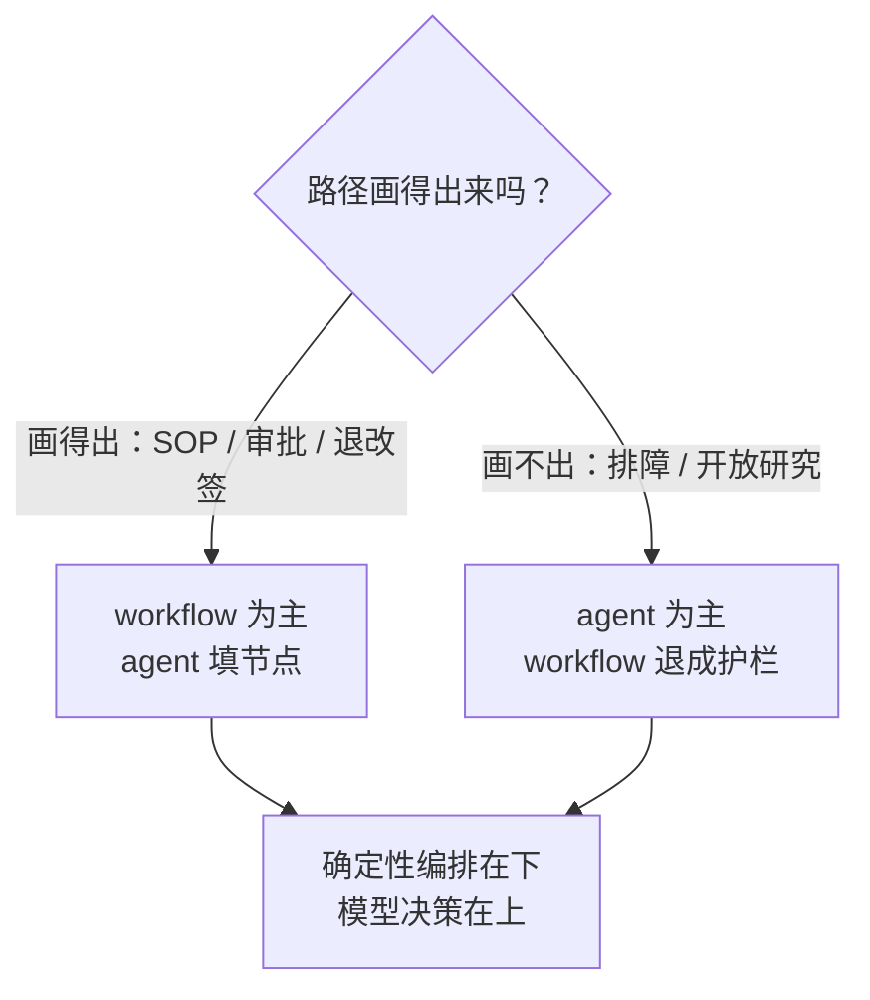
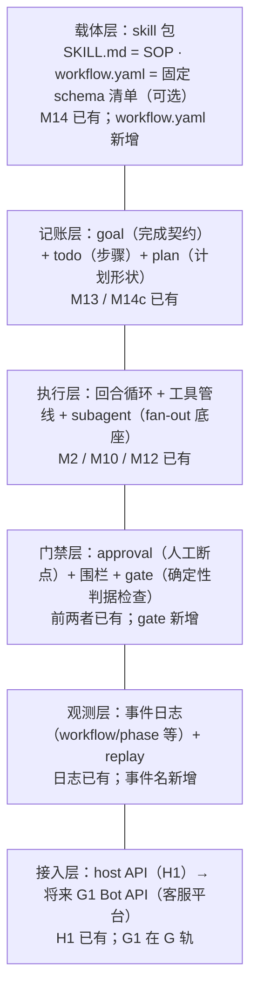
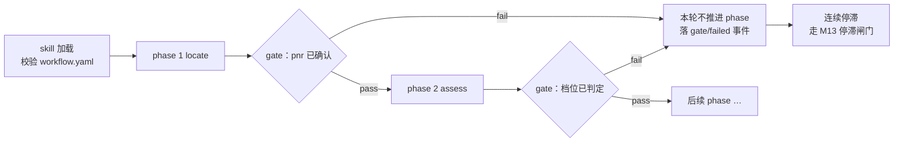
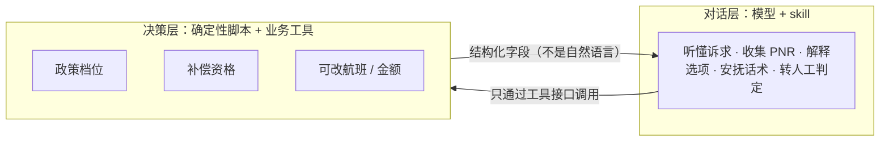

# Workflow 设计分析：从「画流程图」到「发工作手册」

**日期**：2026-11-23 · **性质**：分析与设计建议文档（不是 OpenSpec 规格，不产生 change）
**触发**：如何为 mini-harness 设计 workflow 能力（最简 + 完整实现）、多套 workflow 插件式共存、以及民航客服场景的 workflow 落地
**续篇**：`docs/analysis-workflow-paradigm-shift-2026-11-23.md`（范式更迭核心认知、harness workflow 能否取代传统 workflow、客服 SOP 最佳实践十条）
**读者**：项目维护者（人）。本文严格分区「可验证事实」与「个人推测/设计建议」，见 §9。

**图索引**：图 1 主导权判据（§2.2）· 图 2 六层分解（§3.1）· 图 3 phase 与 gate 推进（§5.2）· 图 4 两层分离（§7.2）。四张图用 Mermaid 写在正文，随文档版本化。

**一句话**：workflow 能力拆成六层，载体是 skill 包、执行靠既有回合循环，真正新增的只有 gate 与三个 workflow 事件——不引入图引擎，也不引入语言运行时。

---

## 0. 先把词说清楚（术语的背景概念）

按「先拆背景、再说本词」的顺序讲。如果你已经熟悉，直接跳到 §1。

**回合循环（agent loop）**。日常类比：一个「听指令 → 干活 → 汇报 → 再听」的办事员循环。技术定义：模型收到上下文 → 决定调工具或给最终答复 → 工具结果回填 → 再次决策，直到模型不再调工具。落点：`src/mini_harness/` 的回合主循环（不变量 C）。

**harness（执行框架）**。类比：办事员身上的「外骨骼 + 工位」——不替他动脑，但管工具、台账、权限、预算。技术定义：围绕模型的执行系统，管上下文装配、工具管线、围栏、日志。落点：mini-harness 整个项目就是一个 harness。

**workflow（工作流）**。类比：**菜谱**——先洗菜再下锅再调味，顺序写死，每步有验收标准。技术定义：把多步骤任务预先编排成固定路径（节点/阶段 + 顺序 + 分支 + 门），逐步执行。与之相对的是「让厨师自由发挥」——由模型运行时决定下一步（agent 范式）。

**skill（技能）**。类比：**随身工作手册里的一章**——教「这类事在我们这儿怎么做」。技术定义：一个以 `SKILL.md` 为核心的目录包，装过程知识（步骤、边界、验收、参考文件、脚本）。落点：M14 已实现（`docs/reference/skills-and-commands.md`）。

**goal（目标）**。类比：**验收单**——只写「什么算完」，不规定路线。技术定义：持久目标对象 + 轮次续跑 + `blocked` / `stalled` 判定。落点：M13（`docs/reference/goal-rounds.md`）。goal 与 workflow 的关系是互补：goal 管「终点」，workflow 管「路径」。

**PTC（Programmatic Tool Calling）**。类比：把「一排按钮」换成「一张工作台」——你在台上写一小段程序，一次串起多个动作。技术定义：DSH 的一种工具调用形态，工具能力被挂载进受控 guest 代码运行时，模型写脚本批量、分支、循环调用。落点：DSH 的 `dsh-workflow-ptc`（见 §1.2）；**mini 按 AGENTS.md 的「始终不做」清单不做工具面塌缩**。

**渐进式披露（progressive disclosure）**。类比：图书馆只把**书名目录**放桌上，需要哪本再取哪本。技术定义：会话启动只注入技能清单（名字 + 描述），正文与附件按需加载。落点：M14 已实现。

---

## 1. 可验证事实：四条线各自怎么做

本节全部为可查证事实，出处见文末引用。二手来源已标注。

### 1.1 传统可视化 workflow：Coze（工作流 vs 对话流）

扣子官方文档定义了两类低代码编排（《工作流与对话流》《低代码工作流介绍》）：

| 维度 | 工作流（Workflow） | 对话流（Chatflow） |
|---|---|---|
| 场景 | 功能类请求、数据自动化（报告/海报/批处理） | 对话类请求（智能客服、助手、虚拟伴侣） |
| 状态 | 无状态，一进一出 | 有状态，绑定会话、可读历史 |
| 多轮 | 不支持中途等用户 | 原生支持，问答节点可暂停收集信息 |
| 入参 | 完全自定义 | 固定携带 `USER_INPUT` + `CONVERSATION_NAME` |

节点体系：开始/结束、LLM、知识库检索、插件、代码、选择器（条件分支）、循环、批处理、子工作流嵌套、意图识别节点（输出 `classificationId` / `reason` / `entities`，供选择器路由）。执行由工作流引擎做任务调度与状态管理，上下文变量跨节点传递。判据经验（行业实践者总结，二手）：**超过 3 个显式步骤、需要「某些意图必须触发某些动作」、或要接多个插件/API 时升级用 workflow**。

对话流/工作流可互转但有代价：对话流转工作流会失去读历史能力；工作流转对话流补两个预置会话参数（《工作流与对话流》）。

### 1.2 DSH 的 workflow 引擎与 PTC

来自本仓库 `docs/dsh-reference/` 一手逆向材料（静态结构校验过、无视觉复核）：

- **三层分工**：`dsh-workflow`（类型 + Service 定义，服务键 `workflowEngine`）→ `dsh-workflow-ptc`（实现）→ `dsh-tool-workflow`（模型面工具）。
- **执行形态**：编排脚本跑在受 sandboxPolicy 约束的独立 Node 进程 + 空 `vm` context 里；guest 全局**只有 6 个冻结函数**：`agent(prompt, opts)`、`parallel(thunks)`（barrier）、`pipeline(items, ...stages)`（无跨阶段 barrier）、`phase(title)`、`log(message)`、`args`。脚本**无 filesystem / network / timer / Node API**——编排与执行彻底分离：脚本只能写「让谁去做」，干活的是 agent。
- **错误分类学**：`WorkflowError` 带 `fatal` 标志（宿主 `instanceof` 判定，脚本 realm 伪造不出）；普通错降级为 `null`，fatal 直接杀脚本；子代理总数上限触顶「整脚本大声失败」，不静默截断。
- **原语语义**：`parallel` 是 barrier（全到齐才走），`pipeline` 是每项独立走完全部阶段（阶段间无 barrier）。`phase` 发 `workflow/phase` 事件；`log` 通道永不渲染给模型。
- **meta 是数据不是代码**：脚本里 `export const meta` 直接拒绝；只允许 `name` / `description` / `whenToUse` / `phases`。
- **配置面**：`mode: native | ptc | both`，默认 `native`；workflow 工具的上限参数包括 `maxTotalAgents 1000`、`maxItemsPerCall 4096`、`syncTimeoutMs 5000`、`maxResultChars 5e4`。
- **与 goal 的边界**：goal 轮次不是 job（是 followup）；workflow 后台运行是 job。

### 1.3 Codex 的底层 workflow（OpenAI 官方）

- **agent loop 本体**：用户输入 → 组 prompt → 推理 → 模型产出最终答复或工具调用 → 工具结果回填 → 再推理，直到模型给出 assistant 消息（《Unrolling the Codex Agent Loop》）。上下文管理是 harness 的职责之一。
- **harness 分层**（《Unlocking the Codex Harness》）：Codex core = agent loop + 线程生命周期与持久化 + 配置鉴权 + 沙箱工具执行 + MCP/skills 扩展接入；App Server = JSON-RPC 双向协议，把同一 harness 暴露给 CLI / IDE / 桌面 App / 合作方产品。
- **三条集成路径**（Codex-as-a-platform，官方）：`codex exec`（一次性脚本任务）→ Codex SDK（程序化嵌入）→ app-server（产品级长会话 + 流式事件 + 审批）。官方明确定位：**「Agent 进产品，而不是产品进 Agent」**——应用保留自己的界面、审批流与数据面，harness 负责循环。
- 附带可验证的设计论据：同一模型下仅 harness 层的「保留推理 + 上下文压缩」两项优化，ARC-AGI-3 得分从 13.3% 升至 38.3%，输出 token 降到约六分之一（OpenAI 官方博客数据；本文引用为「官方自报」）。

### 1.4 Claude Code 的底层 workflow（Anthropic 官方）

- **循环闭合点**：循环闭在「上下文装配」而不是「模型调用」——每轮重建上下文（系统提示、工具定义、指令文件、历史、工具结果），压缩与按需读文件因此杠杆最大（第三方架构分析，二手；与 Codex 官方描述一致）。
- **Dynamic Workflows（2026-05 发布，官方博客《A Harness for Every Task》）**：模型**为当前任务写一段 JS 编排脚本**，后台 runtime 执行；循环、分支、agent 数量、验证遍数都活在**脚本变量**里而非模型上下文里；每个子代理拿干净的上下文窗口。官方上限：单次运行最多 1,000 个 agent、16 并发。
- **官方总结的常用模式**：classify-and-act（分类后路由）、fan-out-and-synthesize（拆小步并发 + 屏障汇合）、adversarial verification（独立对抗验证）、generate-and-filter、tournament（成对比较淘汰）、loop-until-done（直到无新发现）。
- **Skills**：`SKILL.md` 目录包 + 三级渐进披露（清单 → 正文 → 附件脚本/参考）；技能教「怎么把工具用对」，MCP 提供「能调什么」。Agent Skills 规格由 Anthropic 于 2025-10 推出、2025-12 开放为标准（二手汇编来源）。
- **确定性边缘**：hooks 在固定点（工具执行前/后、会话结束）执行，模型绕不过——「模型负责适应性，hooks 负责护栏」（第三方架构总结，二手）。

### 1.5 2026 年的收敛信号（行业事实 + 二手报道）

- AI Engineer World's Fair 2026 的共识被概括为「The Harness Beats the Model」：模型商品化，价值落在 harness（工具、技能、上下文、权限、验证、成本）（二手综述）。
- 正在成型的分层栈：Coding Agent（外层循环）→ MCP 工具 / Sub-agents / Skills → Context layer → **Workflow layer（确定性编排：Specify → Design → Break down → Implement → Verify）**。关键点：workflow 没有被取代，**下沉成了 harness 的底座**。
- 企业侧：Coinbase（Forge）、Shopify（River）、Ramp（Inspect）自建 harness 同时继续用 Claude Code / Codex 做交互式开发（二手报道）：**自建的是控制面，外购的是执行力**。
- 火山引擎 2026-10-29 公告：Coze 企业版停售（2026-11-30）、旧版套餐 2026-12-31 下线、新版企业套餐不晚于 2027-12-31 到期；官方理由「产品整合」。本仓库已立档三条教训：资产不可迁移、治理不在客户手里、承载不了开放任务（`docs/reference/workflow-paradigms.md`）。
- 持久执行一侧（工程实践者对比，二手）：Temporal（代码定义、事件历史、崩溃恢复、可等人工输入）与可视化画布（n8n 等）**不在同一层竞争**——前者管「怎么可靠跑」，后者管「谁来画」；有人工审批的长流程常用「持久执行运行时 + 业务侧可视化定义层」两层。

### 1.6 民航客服行业在做什么

- 深圳航空（《中国民航报》2026-05-20）：智能 IVR 与文本机器人识别率 94% / 99%；智能化场景从 17 个扩到 353 个；以智能体 + RAG + 知识图谱 + **可视化业务工作流**实现 80% 以上常见航旅问询自动化；「深航飞飞」支持购票、选座值机、退改、航班动态查询，逐步加行李额、餐食预订。
- 行业媒体综合报道（二手，效果数字未经独立核验）：马来西亚航空 2026-02 上线客服 agent（Ada 平台），与订座系统直连查真实订单、登机口、协助值机；KLM、Wizz Air 等有同类部署；Amadeus 与微软 2026-06 报告称语音自动改签等五个方向已产生可测价值。
- 行业报道中反复出现的架构共识：**对话层与业务决策层分离**——改签逻辑、补偿资格等由确定性规则层执行，语言模型只管自然语言交互，避免模型「发明」补偿金额。航班不正常（IRROPS）场景被列为最高复杂度任务：识别受影响 PNR、匹配可改选项、按政策重新安置、出票、写回收入结算，**政策执行不能漂移**。

---

## 2. 分析：workflow 在 harness 里的正确位置

### 2.1 一张表看三种范式

| | 可视化 workflow（Coze/Dify/n8n） | 程序化编排（LangGraph/Temporal） | 自主 harness（DSH/Codex/Claude Code） |
|---|---|---|---|
| 流程由谁定 | 人预画节点连线 | 人写代码/状态图 | 模型运行时决定下一步 |
| 模型角色 | 节点内一个能力 | 图里一个执行者 | 外层循环决策者 |
| 确定性 | 高 | 中 | 低 |
| 可审计 | 强（每步可见） | 中（读代码与 trace） | 弱到中（靠事件日志） |
| 适合 | 路径清楚的标准化任务 | 复杂状态、人工断点 | 开放任务、长时目标 |

### 2.2 两个关键洞察（从事实推出，标注为推断）

**推断一：workflow 没有被 agent 淘汰，而是下沉了。** 证据链：Claude Code 的 Dynamic Workflows 把编排写成**脚本**交给后台 runtime（编排层确定性化）；Codex 把 harness 做成产品底座（应用自己排业务流程）；DSH 的 workflow 引擎里脚本只能「派活」不能「干活」。三家方向一致：**确定性编排在下，模型决策在上**。

**推断二：谁为主由「路径确定性」决定，不由新旧决定。** 路径画得出来（客服 SOP、审批、退改签办理）→ workflow 为主，agent 填节点；路径画不出来（开放式研究、排障）→ agent 为主，workflow 退成护栏（验收条件、预算、禁区）。这个判据在 `docs/reference/workflow-paradigms.md` 已立档，本节用 1.6 的民航证据再确认一次：民航办理类任务恰好是「路径画得出来」的一侧。

**图 1**：主导权由路径确定性决定；两条分支最后收敛到同一条分层原则。



### 2.3 与项目红线的对照（必须遵守）

| 约束 | 来源 | 对 workflow 设计的含义 |
|---|---|---|
| PTC 工具面塌缩**始终不做** | AGENTS.md | 不做「一个 run_code 入口收编所有工具」；不做 JS/TS guest 语言运行时 |
| 完整 workflowEngine / 图引擎**不做** | G 轨不做账 | 不做 DAG 图解释器、不做 DSL；只做最小线性/固定 schema |
| 组合层与扩展层**不新增缝** | AGENTS.md | workflow 的判据写进既有七个 seam（②工具管线 / ⑥CLI 黑盒 / ⑦委派与目标） |
| fork 与插件容器不做、无 HMR | ADR-0035 | 多套 workflow 共存走 skill 根 + git 版本化，不做热插拔市场 |
| 日志唯一真源、失败也是结果 | 不变量 A/B | workflow 的每个阶段必须落可重放事件；门不过 = 结果词不是异常 |
| workflow 类能力排在 **E1 之后** | workflow-paradigms.md §四 | 没有 held-out 基线前不加编排，否则无法判断变好还是变复杂 |

---

## 3. 设计：mini 的 workflow 分层

（本节起为**设计建议**，全部标注为推断/建议，待人裁决。）

### 3.1 六层分解

把「workflow 能力」拆成六层。注意：**下面没有一行要求新语言运行时**——载体是 skill 包 + 现有内核原语。



**图 2**：六层分解，自上而下是「声明 → 记账 → 执行 → 门禁 → 观测 → 接入」，**不是调用链**；每层标注的是当前落地状态。

### 3.2 与 goal 的分工

goal 是「什么算完」的验收单，workflow 是「按什么路线走」的路径契约。一次民航办理 = 一个 goal（例如「MU5101 改签完成并出票」）+ 一个 skill 提供的路径（SOP）+ todo 记账推进。goal 轮次就是 workflow 的执行载体，不需要第二个循环。

---

## 4. 最简实现（零新代码，今天就能跑）

### 4.1 形状

一套 workflow = **一个 skill 目录**，全部用 M14 既有机制：

```
.minihns/skills/ca-irrops-rebooking/
├── SKILL.md          # frontmatter（name/description/策略位）+ SOP 正文
├── references/       # 改签政策表、补偿规则、话术（按需读）
└── scripts/          # 确定性校验（如补偿资格判定，bash/python 直接跑）
```

### 4.2 机制（谁在何时做什么）

1. **触发**：人敲 `/ca-irrops-rebooking MU5101`（M14 命令面），或模型按清单描述自动 `skill` 工具加载；平台消息进来时由 G1 映射成会话消息走同一条路。
2. **展开**：SOP 正文进上下文 → 模型把步骤写进 `todo` → goal 以「办理完成」为验收契约 → goal 轮次自动续跑。
3. **人工断点**：需要旅客确认/坐席审批的步骤用 `ask_user`；写操作走 approval（默认 ask）。
4. **确定性步骤**：政策计算、资格判定**不进提示词**——skill 里指明「跑 `scripts/check_eligibility.py`，读 `references/policy.md` 第 3 节」，工具结果就是事实。
5. **收口**：goal 的完成判据逐条核对（出票号存在、回执已发）；不过则 `blocked`（M13 同一阻碍三轮）或交回人类。

### 4.3 语义（默认值与边界）

- SOP 是**软路径**：模型可以绕行，但 goal 验收与 gate 不放水。这适合路径偶有弹性的场景。
- 并发：批量改签这类同构任务用 `subagent` 工具天然并发（M12 判据：同批真并发），fan-in 由父会话收结果——这是 DSH `parallel` 语义的手工版。
- 判据落点：seam ⑥（命令面黑盒）+ seam ⑦（goal 推进）。

### 4.4 完成判据（可验收）

- 一个真实民航 SOP 写成 skill 后，`/技能名` 触发 → goal 轮次里 todo 推进 → 人工断点得到 `ask_user` 回答 → 审批通过后完成办理，`replay` 逐点相等。
- 同一 skill 在 CLI 与 host 的命令面行为一致（M14 既有判据复用）。

---

## 5. 完整实现（固定 schema，仍不做图引擎）

### 5.1 增量：workflow.yaml（声明清单，不是 DSL）

在 skill 包内加一份**固定 schema** 的声明文件（字段封闭、无用户自定义表达式语言）：

```yaml
# workflow.yaml —— 形状建议，字段与默认值待裁
version: 1
name: ca-irrops-rebooking
goal_contract: "改签完成：出票号存在且回执已发"
max_rounds: 12
phases:
  - id: locate        # 阶段 = DSH phase() 的声明式对应物
    gate: "pnr 已确认"          # 确定性判据，由脚本/工具结果判定，不由模型自评
  - id: assess
    gate: "延误原因与政策档位已判定"
  - id: offer
    gate: "候选航班列表非空"
  - id: confirm
    human_gate: true            # ask_user / 审批断点
  - id: execute
    approval: ask               # 写操作审批档位
  - id: receipt
    gate: "出票号已写入回执"
limits:
  tools: [flight_status, pss_rebook, pnr_get, ask_user, present]
```

### 5.2 机制：最小 runner（几十行解释器，不是引擎）

- **装配期**：skill 加载时若发现 `workflow.yaml`，校验 schema（固定字段，非法整体拒绝——照 DSH 的 `assertObjectJsonSchema` 思路但用 pydantic），把 `phases` 初始化进 todo，goal 取 `goal_contract`。
- **推进期**：goal 轮次照旧跑；**gate 是确定性代码**——每个 phase 结束由 runner 检查 gate 表达式（只允许「工具结果字段的布尔组合」这一种形态），不过则该轮不推进 phase、结果记 `gate/failed` 事件，连续停滞走 M13 停滞闸门。
- **批量原语**（对齐既有裁定「固定 schema 批量原语，不做 DSL」）：先两个——`fan_out`（同构任务并发派 subagent + barrier 汇合，对应 DSH `parallel`）与 `pipeline`（逐项串阶段，对应 DSH `pipeline`）。实现上就是「预生成 N 个 todo 条目 + 按 M12 并发派子代理 + 父会话收结果」，不动回合循环。
- **观测**：新增三个事件名 `workflow/start`、`workflow/phase`、`workflow/end`（含 `gate` 结果），落 JSONL、可 replay——照 DSH 的 `workflow/phase` 命名风格。事件类型扩展走插件声明合并的既有路径或 core 事件表，需一个 ADR 记录形状。
- **失败语义**（照 DSH 错误分类学裁剪）：gate 不过 = 结果（不是异常）；`max_rounds` 耗尽 = goal 收尾交人；schema 非法 = 该 skill 不加载、日志记警告。

**图 3**：phase 推进只有一个准入点——gate 判定；gate 不过则该轮不推进 phase，连续停滞交给 M13 的停滞闸门。



### 5.3 明确不做（与红线一致）

图引擎/DAG 解释器、用户自定义表达式语言、脚本 guest 运行时、工具面塌缩、热更新插件市场、多模型路由、workflow 版本热切换（换版本 = 下一会话生效，照 M14 技能快照语义）。

### 5.4 完成判据

- 带 gate 的 skill：人为改坏一个工具结果 → 对应 gate 不过 → phase 不推进且事件可见 → 修好后继续；`replay` 逐点相等。
- `fan_out` 派 8 个子任务 wall-clock 小于串行基线（E1 记账）。
- 无 `workflow.yaml` 的普通 skill 行为逐点不变。

---

## 6. 多套 workflow 插件式共存

### 6.1 机制：skill 目录就是插件市场（零新注册表）

| 关注点 | 机制 | 状态 |
|---|---|---|
| **包格式** | skill 目录（SKILL.md ± workflow.yaml + references + scripts） | 已有 |
| **发现** | M14 四级根（项目 100 / 共享 200 / 用户 400 / 内置 600），同名高优先 | 已有 |
| **发布** | git 合入对应 skill 根；`workflow.yaml` 过 schema 校验可挂 pre-commit/CI | 建议 |
| **配置** | frontmatter 策略位（`user-invocable` / `disable-model-invocation`）+ `mini.config.toml` preset | 已有 |
| **调用** | 人：`/<技能名>`；模型：清单匹配 + `skill` 工具；平台：G1 入站 → 会话消息 | 已有（G1 在 G 轨） |
| **隔离** | `[subagent.presets.<id>.skills]` scope 层（skill-providers 规划）：民航 preset 只挂 `ca-*` | 部分已有 |
| **冲突** | 命名空间前缀（`ca-` / `fin-`）+ description 写明 when / not-when + 同名覆盖规则 | 建议 |
| **版本** | git tag + `workflow.yaml` 的 `version` 字段；升级 = 重新发现，会话内用快照 | 建议 |
| **观测** | `session/start.payload.skills` 清单审计 + command/run 两件套 | 已有 |

**为什么这成立**：Coze 教训的反面就是「资产进自己的 git、治理在自己的注册表」。skill 包在 git 里 = 可迁移、可 review、可回滚；四级根 = 多套并存天然支持；渐进披露 = 挂 50 个民航 workflow 不撑爆上下文。

### 6.2 「插件式共存」的一个具体形态（建议）

一个民航客服部署 = 一个 **preset**（场景包）：

```toml
[workflow_sets.civil-aviation]
skills = ["ca-irrops-rebooking", "ca-refund", "ca-checkin", "ca-baggage", "ca-faq"]
# 每个 skill 自带 SOP + 可选 workflow.yaml；preset 决定挂哪一套
```

不同业务线（民航 / 金融 / 内部 IT）各一个 preset，共享同一内核——这就是「多套 workflow 共存」的答案：**共存单位是 skill 包，选择单位是 preset，运行单位是 goal 轮次**。

---

## 7. 民航客服示例：不正常航班改签（IRROPS）

### 7.1 为什么选它

路径确定性最高（政策写死）、后果真实（出票/退款）、突发洪峰需要批量（天气大面积延误）、合规强（补偿资格不能让模型算）——正好把 workflow 的每个部件都用上。

### 7.2 两层分离（行业共识的落地）



**图 4**：两层只通过工具接口进出；模型不直接产生「金额 / 资格」结论。

### 7.3 一次办理的流程（最简版 skill SOP → 完整版 phases）

| 阶段 | 谁干 | gate（完整版） | 失败去向 |
|---|---|---|---|
| ① 定位：确认旅客与 PNR | 模型 + `ask_user` + `pnr_get` | pnr 已确认 | 问不到 → 交回人类 |
| ② 态势：查延误/取消原因 | `flight_status` 工具 | 原因码已取到 | 工具失败=结果，兜底话术 |
| ③ 政策：判改签/补偿档位 | `scripts/check_eligibility.py` | 档位已判定 | 脚本报错=结果，转人工 |
| ④ 呈现：列候选航班 | `flight_search` 工具 | 列表非空 | 空 → 提示转人工 |
| ⑤ 确认：旅客选方案 | `ask_user`（人工断点） | 选项已确认 | 超时 → handoff 信号 |
| ⑥ 执行：改签出票 | `pss_rebook`（approval: ask） | 出票号存在 | 拒绝/失败 → handoff |
| ⑦ 回执：确认单 + 记账 | `present` + goal 收口 | 回执已发 | — |

- **洪峰批量**：①–④ 对受影响 PNR 列表 `fan_out`（每 PNR 一个 subagent），⑤–⑥ 逐个或批量人工确认后执行。
- **转人工**：mini 只发 handoff 信号（G1 契约已有 `handoff: {needed, reason}`），队列/坐席/质检归客服平台（G 轨不做账）。
- **PII**：PNR/证件不进日志原文，走最小脱敏（G 轨 SLA/PII 最小面已有原则）。

### 7.4 民航能力全景（对照深航公开案例）

深航公开的场景面（购票、值机、退改、航班动态、行李、餐食）正好一一对应一个 skill 包；「80% 以上常见问询自动化」在架构上对应 **FAQ 类 skill（RAG）+ 办理类 skill（workflow）** 两组——前者最简版就够，后者用本文的最简 → 完整两步走。

---

## 8. 实现方法论：四阶段，循序渐进

### 8.1 四阶段路线

| 阶段 | 做什么 | 依赖 | 完成判据 | 估计体量 |
|---|---|---|---|---|
| **P0 手工编排**（现在） | 民航 SOP 写成 2–3 个 skill，纯文本；用 goal/todo/ask_user/subagent 跑通一次真实办理 | M13/M14c 已完成 | UAT：一次改签从咨询到出票走通，人跑 | 零代码 |
| **P1 批量原语** | `fan_out` / `pipeline` 两个固定 schema 原语（change 一个） | E1 有基线后 | 并发 wall-clock 判据 + replay 相等 | 小 |
| **P2 manifest + gate** | `workflow.yaml` schema + 最小 runner + 三个 workflow 事件（change 一个） | P1 | gate 判据 §5.4；普通 skill 行为不变 | 中 |
| **P3 场景包上线** | G1 对接客服平台 + 业务工具连接器（PSS/航班动态）+ preset 场景包 | G 轨启动（personal-baseline-v1 之后） | G1 完成判据 + 一组真实 FAQ/业务问题达标 | 大，属 G 轨 |

### 8.2 三条纪律


1. **每个阶段一个 OpenSpec change**，propose 前先对照 DSH 一手实现（尤其 `dsh-workflow` 的接缝与错误分类学）。
2. **判据钉值不钉形状**；每个 Scenario 先列坏法清单（例：gate 被模型「口头满足」——所以 gate 必须由脚本判，不进提示词）。
3. **收尾四项不变**：真实端点验收、UAT、变异测试、Learning Gate。变异重点：改坏 gate 判定、改坏并发上限、改坏事件顺序，看有没有测试变红。

---

## 9. 事实与推测的分界（按约定强制标注）

### 9.1 可验证事实（§1 全部）

- Coze 工作流/对话流定义与节点体系——扣子官方文档。
- DSH workflow 引擎三层、6 个冻结全局、错误分类学、原语语义——`docs/dsh-reference/` 一手逆向。
- Codex agent loop、harness 分层、三条集成路径、ARC-AGI-3 数据——OpenAI 官方博客。
- Claude Code Dynamic Workflows 六模式、Skills 三级披露、hooks——Anthropic 官方博客（模式清单）；架构细节部分为二手综述。
- Coze 企业版下线时间表——火山引擎公告（经 `workflow-paradigms.md` 转录）。
- 深航智能客服数据与场景面——《中国民航报》2026-05-20。
- 本项目红线与既有机制（goal/skill/preset/围栏/日志）——仓库内文档与规格。

### 9.2 个人推测 / 设计建议（§2.2、§3–§8 全部）

- 六层分解、workflow.yaml 字段形状、runner 语义、preset 场景包、四阶段路线——均为本文建议，**未经实现验证，需人裁决**。
- 「路径确定性」作为范式选择判据——由多源事实归纳的推断，不是任何一家的原话。

### 9.3 已剔除（不可查证或仅预测性内容，按约定不采信）

- 「40% 企业应用内嵌 agent」「2028 年 1/3 工作流 agentic」等预测数字。
- 未经独立核验的市场/效果数字（如部分厂商对比文中的自动化率提升幅度、企业成本数字）。
- Coze 停服后客户流向的任何断言（无公开数据）。

---

## 引用（MLA）

1. 扣子。《工作流与对话流》。*扣子开放文档*，coze.cn/open/docs/guides/workflow_and_chatflow。查阅于 2026 年 11 月 23 日。
2. 扣子。《低代码工作流介绍》。*扣子开放文档*，docs.coze.cn/guides_workflow。查阅于 2026 年 11 月 23 日。
3. OpenAI。《Unrolling the Codex Agent Loop》。*OpenAI*，openai.com/index/unrolling-the-codex-agent-loop。查阅于 2026 年 11 月 23 日。
4. OpenAI。《Unlocking the Codex Harness: How We Built the App Server》。*OpenAI*，openai.com/index/unlocking-the-codex-harness。查阅于 2026 年 11 月 23 日。
5. OpenAI。《Codex as a Platform: Build on the Open Agent Harness》。*OpenAI Developer Blog*，developers.openai.ac.cn/blog/codex-as-a-platform。查阅于 2026 年 11 月 23 日。
6. Claude。《A Harness for Every Task: Dynamic Workflows in Claude Code》。*Claude*，claude.com/blog/a-harness-for-every-task-dynamic-workflows-in-claude-code。查阅于 2026 年 11 月 23 日。
7. 高雅娜。《智慧赋能 深圳航空：把人工智能"写进"每一个场景》。*中国民航报*，2026 年 5 月 20 日，转载于 m.163.com/dy/article/KTD9GCS50553RYPC.html。查阅于 2026 年 11 月 23 日。
8. "Agentic AI in Travel: What Airlines Are Actually Doing in 2026." *OneClick TravelTech*（二手行业报道），oneclicktraveltech.com/blogs/agentic-ai-in-travel-airlines-2026。查阅于 2026 年 11 月 23 日。
9. "How Conversational AI Could Redefine Airline Customer Support." *Globik AI*（二手行业报道），globik.ai/blogs/how-conversational-ai-could-redefine-airline-customer-support。查阅于 2026 年 11 月 23 日。
10. "AI Agent Skills in 2026: Composable Capabilities, Progressive Disclosure…" *Reactify Solutions*（二手汇编），reactify-solutions.com/articles/ai-agent-skills-2026。查阅于 2026 年 11 月 23 日。
11. "n8n vs Temporal vs Prefect: Visual Workflows or Workflows as Code?" *Osher Digital*（工程实践者对比），osher.com.au/blog/n8n-vs-temporal-vs-prefect。查阅于 2026 年 11 月 23 日。
12. 《Workflow 的三种范式与 2026 年的收敛》。本仓库 `docs/reference/workflow-paradigms.md`，2026 年 11 月 23 日立档。
13. 《DSH 运行时架构剖析》。本仓库 `docs/dsh-reference/DSH运行时架构剖析.html`（一手逆向汇编）。

---

## 开放问题（需要人裁决的分叉，按项目规矩摆读法）

1. **gate 的判定语言**：读法 A——gate 只允许「工具结果字段的布尔组合」（最简，本文建议）；读法 B——gate 允许跑 `scripts/` 下的退出码（更强，但引入脚本可信问题）。二选一或分层。
2. **workflow.yaml 放哪**：读法 A——skill 包内（本文建议，随包迁移）；读法 B——独立 `workflows/` 目录（与 skill 解耦，但多一个注册面）。
3. **P1 批量原语的归属**：读法 A——做成工具（模型可调，走 seam ②）；读法 B——做成装配期原语（只有 runner 可展开，模型只能声明）。本文倾向 B（更贴近 DSH「脚本只能派活」），但 A 更符合「工具是能力契约」。
4. **G1 触发映射**：平台消息触发办理 workflow 时，goal 由平台侧声明（外部系统给验收单）还是 skill 默认 goal_contract？涉及多 goal 并行（`parallel-goal-scheduler` 目前 deferred），建议先单 goal、平台消息排队。
