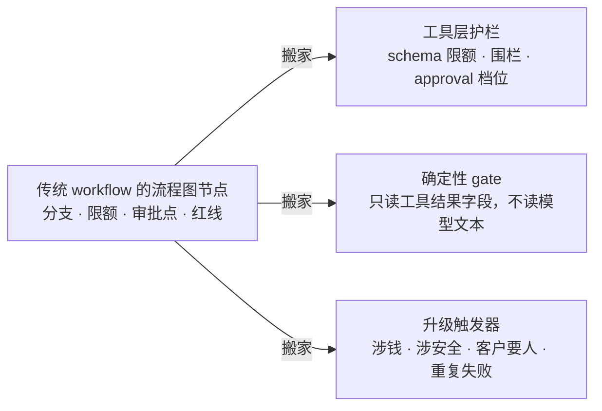
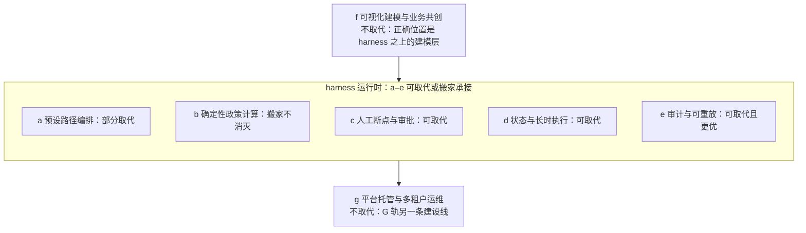
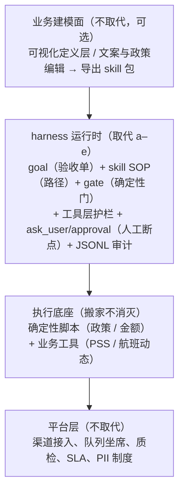

# 补充分析：范式更迭的核心认知——harness workflow 能否取代传统 workflow

**日期**：2026-11-23 · **性质**：分析与设计建议（不是 OpenSpec 规格）· **前篇**：`docs/analysis-workflow-design-2026-11-23.md` · **续篇**：`docs/analysis-workflow-invariants-2026-11-23.md`（三前提保证机制、取代不变量集、结构化表达层）
**问题**（用户原问拆成三个）：① 「不是替代，是分层」背后的更迭核心认知与逻辑是什么；② 基于 harness 的 workflow（DSH PTC / Claude Code / Codex，按 skill 声明执行）能否取代传统 workflow，特别是在客服 SOP 领域；③ 若能全部或部分取代，行业最新最佳实践的设计方案是什么。
**约定**：§1–§4 为可验证事实与出处明确的行业实践；§5–§6 为个人推测/设计建议；§7 强制分区并剔除不可查证内容。引用见文末（MLA）。

**图索引**：图 1 确定性的三个新住处（§1.5）· 图 2 七能力按层取代（§2.4）· 图 3 分层落地最终形态（§5.3）。三张图用 Mermaid 写在正文，随文档版本化。

**一句话**：不是 agent 消灭 workflow，而是决策权分层——路径确定性归确定性层（gate / 工具 / 脚本），临场决策归模型层，资产从平台图搬进 git。

---

## 0. 先拆背景词

**BPM（Business Process Management，业务流程管理）**。类比：工厂的「工艺流程图 + 质检单」。技术定义：把业务流程画成显式模型（节点 + 顺序 + 分支），用流程引擎逐步执行、监控与优化的老学科。它的现代形态是低代码画布（Coze / Dify / n8n 一类）。

**RPA（Robotic Process Automation，机器人流程自动化）**。类比：一个照着脚本点鼠标填表的「数字员工」。技术定义：按固定规则自动执行界面/API 操作的旧一代自动化，不理解语义，遇例外即失败。

**SOP（Standard Operating Procedure，标准作业程序）**。类比：**贴在墙上的操作规程**。技术定义：一类任务的标准化步骤、判定条件、例外处理与红线。客服 SOP 通常三合一：知识（怎么答）+ 流程（怎么办）+ 红线（什么不能做/必须升级）。

**影子模式（shadow mode）**。类比：新员工先在旁边「模拟办件」，老员工签字才生效。技术定义：agent 给出建议但不执行，由人决定并执行，用于上线前校准。

**交接载荷（handoff packet）**。类比：转科时医生写的「病情摘要」。技术定义：升级转人工时随会话一起传给坐席的结构化摘要（意图、已做动作、置信度、依据、未决问题）。

**取代判断中的三个词**：**可取代**（harness 侧有等价物且更优）；**搬家不消灭**（能力保留但换了载体，从流程图节点搬进代码/工具）；**不取代**（harness 侧没有对应物，属于另一层的产品）。

---

## 1. 范式更迭的核心认知（五条，全部有出处）

### 1.1 认知一：价值从「画路径」转移到「管边界」

可验证事实：AI Engineer World's Fair 2026 的共识被概括为「The Harness Beats the Model」——模型在商品化，价值落在 harness（工具、技能、上下文、权限、验证、成本）（二手综述，前篇已引）。OpenAI 在官方博客中用同一模型（GPT-5.6 Sol）证明：仅 harness 层的「保留推理 + 上下文压缩」两项优化，ARC-AGI-3 得分从 13.3% 升至 38.3%（OpenAI 官方数据）。

**逻辑**：传统 workflow 产品的核心资产是「路径图」；harness 时代的核心资产是「边界与上下文的工程」。路径图擅长封闭任务，但路径图解决不了「下一步做什么需要临场判断」的任务——这正是传统 airline chatbot 自动化率停在 25–30% 的原因（行业报道，二手）。

### 1.2 认知二：决策权分层——路径确定性决定主导权，不由新旧决定

可验证事实：Claude Code 的 Dynamic Workflows 把循环、分支、验证遍数写进**编排脚本**交给后台 runtime 执行，模型只负责生成脚本与各步决策（Anthropic 官方）；DSH 的 workflow 脚本跑在空 vm 里，只能「派活」不能「干活」（本地一手逆向）；Codex harness 把「业务怎么排」留给应用，自己只管循环、沙箱与审批（OpenAI 官方）。

**逻辑**：三家在同一件事上分层——**「哪些步骤必须按顺序、哪些门必须过、什么算验收」归确定性层；「下一步具体做什么」归模型层**。谁为主由任务的路径确定性决定：画得出流程图的任务（客服 SOP、审批、退改签）以确定性骨架为主；画不出的（排障、开放研究）以模型为主、确定性退成护栏。前篇 §2.2 已立此判据，本篇用客服证据再次确认。

### 1.3 认知三：资产形态迁移——从平台图到仓库文件

可验证事实：火山引擎公告 Coze 企业版停售（2026-11-30）至全线不晚于 2027-12-31 到期，公告承诺另行说明资源导出与备份（火山引擎公告，前篇已引）。本仓库已立档三条教训：资产不可迁移、治理不在客户手里、承载不了开放任务（`docs/reference/workflow-paradigms.md`）。Agent Skills 开放标准（`SKILL.md` 目录 + git 版本化）被 Claude Code、Codex CLI、Cursor 等多家接受（二手汇编）。

**逻辑**：Coze 下线证明的不是「可视化编排失败」，而是「**画在平台上的图不是你的资产**」。新范式的资产形态是仓库里的 skill 包 + 配置 + 策略——可 review、可回滚、可随 git 迁移。这是企业迁移的直接动因。

### 1.4 认知四：产品嵌入方向反转——Agent 进产品，不是产品进 Agent

可验证事实：OpenAI 官方提出「把 agent 能力嵌进团队本来就在用的软件——工程工作流、运维看板、安全调查台、客服控制台」，并给出 exec / SDK / app-server 三条集成路径；JetBrains、Cisco 等按此模式集成（OpenAI 官方博客）。同理，Tempora 一类持久执行运行时与可视化建模层被明确为**不同层**：运行时管可靠执行，建模层管谁来画（工程实践者对比，二手）。

**逻辑**：传统 workflow 产品要求业务「搬进平台」；harness 范式反过来——**harness 是引擎，产品保留自己的界面、审批流与数据面**。这解释了客服领域的落地形态：客服平台不消失，消失的是「平台里那套私有工作流资产」。

### 1.5 认知五：确定性没有消失，而是换了住处

可验证事实：客服 agent 实践者的共识是「权限与限额**在工具/API 层强制，不依赖提示词**」（QwickAI、CorePiper 等实践指南）；「SOP 定义决策树，护栏定义决策树在哪里终止为升级而不是动作」（CorePiper）；高后果升级用确定性规则触发，模型分类只用在可容错处（Axtra）。

**逻辑**：传统 workflow 的确定性（分支、限额、审批点、红线）没有被模型「学走」，而是从流程图节点**搬进三个新住处**：工具层护栏、确定性 gate（脚本判据）、升级触发器。「不是替代，是分层」的准确表述是——**确定性从「图的位置」下沉到「执行的位置」**。

**图 1**：确定性没有消失，而是从「图的位置」搬到「执行的位置」；三个新住处各有对应的落地件。



---

## 2. 能否取代：把「传统 workflow」拆成七个能力逐一判断

### 2.1 七个能力逐项判断

（本节矩阵为**分析框架**，判断结论属个人推断；每格的事实依据在括号里注明出处。）

| # | 能力 | 传统 workflow 的实现 | harness 侧对应物 | 取代判断 |
|---|---|---|---|---|
| a | 预设路径编排 | 画布节点 + 连线 | skill SOP（软路径）/ manifest + gate（硬路径） | **部分取代**：封闭 SOP 可取代（前篇 §4/§5）；开放任务不该预画路径（Claude 官方博客的 late-binding 论证） |
| b | 确定性政策计算 | 代码节点 / 规则引擎 | `scripts/` 确定性脚本 + 工具内规则 | **搬家不消灭**：模型不得产生金额/资格结论（民航行业共识，前篇 §1.6） |
| c | 人工断点与审批 | 问答节点 / 审批节点 | `ask_user` + approval（M14c/H1 已有） | **可取代**：harness 原生支持，且子代理不继承放行（M12 语义更严） |
| d | 状态与长时执行 | 会话绑定 / 工作流实例 | goal 轮次 + JSONL 日志 + `--resume`（M11/M13） | **可取代**（个人基线内）；跨周多实例调度属 G 轨 G2，不在内核 |
| e | 审计与可重放 | 平台运行记录 | 事件日志唯一真源 + `replay` 逐点相等（不变量 A/F） | **可取代且更优**：前提是 workflow 事件结构化（前篇 §5.2） |
| f | 可视化建模与业务共创 | 画布 + 权限协作 | **无对应物**（skill 是文本，读者是工程师/agent） | **不取代**：这是残余市场，正确位置是 harness 之上的建模层 |
| g | 平台托管与多租户运维 | 平台自带 | G 轨自建（G0–G5） | **不取代**：属于另一条建设线，G 轨不做账已定 |

### 2.2 为什么「全部取代」不成立——三条硬约束

1. **可靠性连乘**。示例计算（假设，非实测）：若单步成功率为 95%，十步流程的整体成功率是 0.95¹⁰ ≈ 59.8%。这个算术本身可验证，但「95%」是假设值——它说明的结构性问题是：**模型逐步决策会把每步误差连乘**，而流程图引擎每步是确定性的，误差只来自节点内的模型调用。约束结论：步骤越多，越要把「顺序与门」交给确定性层。
2. **成本与延迟**。确定性路由（意图分类 → 分支）用规则或小模型即可，用大模型逐轮决定「走哪条线」在大批量客服流量下不经济——这是实践者给出的分级路由理由（工具对比文章，二手）。
3. **建模用户错位**。Coze 画布的用户是**业务/运营 + IT**（官方定位）；skill 包的读者是工程师与 agent。没有可视化建模层，业务人员无法参与改流程——这不是技术缺陷，是用户分工问题。

### 2.3 为什么「全都不取代」也不成立

平台三教训（认知三）加上开放任务天花板：路径需要动态展开时图会爆炸（`workflow-paradigms.md` 立档）。同时 harness 侧已有等价物覆盖 c/d/e（上表），民航深航案例显示 80% 以上常见问询可自动化——这正是「a/b/c/d/e 五项被部分或全部取代」的现实结果（《中国民航报》，前篇已引）。

### 2.4 结论：按层取代

**按层取代，不是整体取代**。运行时层（a–e）可被 harness workflow 取代或承接；建模面（f）与平台运维（g）不取代，前者收缩为 harness 之上的可视化定义层，后者属于 G 轨。

**图 2**：七个能力按层取代——运行时五能力在 harness 内，f 在 harness 之上，g 属平台层。



---

## 3. 客服 SOP 领域的特殊判断

### 3.1 SOP 三合一 → 三个去处

| SOP 成分 | 例子 | 新范式的去处 | 取代判断 |
|---|---|---|---|
| 知识（怎么答） | 退票政策、行李额 | RAG/知识库 + skill `references/`（带引用） | 可取代（答案必须落知识库，不许模型凭记忆答政策——QwickAI 明确列为常见错误） |
| 流程（怎么办） | 改签七步、核身 | skill SOP + gate + 工具序列 | 可取代（封闭流程）；复杂例外仍升级 |
| 红线（不能做什么） | 退款限额、禁止删记录 | **工具层护栏 + 审批门**（不在提示词） | 搬家不消灭：护栏必须是架构约束（CorePiper） |

### 3.2 客服场景里 harness 真正强于传统 workflow 的三点

1. **例外处理**。传统流程图的死穴是例外——遇到模板外的输入要么卡死要么重来（行业报道反复出现此结论，二手）；harness 的模型层恰好擅长临场处置，而把「处置不了一定升级」写成 gate 就收住了风险。
2. **升级交接质量**。实践者共识：交接载荷（意图、摘要、已试动作、置信度、依据片段、未决问题）是人工效率的最大决定因素（Corebee、Axtra）；harness 的日志天然提供全量过程，`ask_user`/goal 事件天然记录未决问题——这比流程图引擎的「转人工节点只有一个会话 ID」强。
3. **可重放审计**。民航合规要求逐动作审计轨迹（行业报道，二手）；不变量 A/F 的 JSONL + replay 比平台「运行记录」更硬。

### 3.3 客服领域不能取代、必须留给「平台/人」的部分

- 转人工队列、坐席分配、质检评分、SLA 报表——G 轨不做账已定，mini 只发 handoff 信号。
- 业务人员改流程的建模界面——若需要，做在 harness 之上（认知四），不在内核里造画布。
- 合规制度（consent、留存、DSR）——归平台；mini 只做日志不泄 PII、最小脱敏、可删（G 轨最小面已定）。

---

## 4. 行业最新最佳实践的设计方案（2026 实践者共识）

以下十条全部出自 2026 年公开的客服 agent 实践指南/部署报告（多为从业者总结，属可查证的「谁说了什么」；其效果数字本文不采信）。这是「部分取代」路线图的行业最佳实践。

1. **三个意图起步，无聊制胜**。首批只自动化三类工单：高频、低风险、判定明确（如订单状态、小额退款、密码重置）；两周内拒绝扩围（Corebee）。
2. **自动化阶梯**。能力分四级：Answer（答）→ Look up（查）→ Act（办）→ Escalate（升级）；行动侧分四阶段：信息 → 建议 → 确认后执行 → 自主执行，每阶段有前置条件（QwickAI、Mavik Labs）。
3. **知识落地 + 置信度阈值**。回答必须出自知识库并给来源；检索置信度低于阈值（实践者常用 70–80% 起始）就升级，「grounded answers or nothing」（Corebee、QwickAI）。
4. **硬护栏放工具层**。退款限额、身份核验、频次限制、禁止删除记录——在 API/权限层强制，不依赖模型遵守提示词（QwickAI、CorePiper）。
5. **SOP + 护栏双件套**。SOP 定义决策树，护栏定义树在哪里**终止为升级**而不是动作；只有 SOP 没有护栏，模型遇边界会即兴发挥（CorePiper）。
6. **先设计交接载荷**。升级时人工收到：完整对话、置信度、参考过的知识片段、工单分类、升级原因、建议动作；上线前就把这个 UI/格式定下来（Corebee、Axtra）。
7. **高后果升级用确定性触发器**。涉钱、涉安全、客户明确要人、重复失败——用规则触发；模型分类只用在可容错处（Axtra、Mavik）。
8. **度量真实解决率**。追踪「7 天内未重开」的解决率、升级质量、每次解决成本，而不是转人工率/拦截率——后者会奖励「客户放弃」（QwickAI、Axtra）。
9. **受控发布**。单渠道起步（通常网站聊天）、影子模式校准、A/B 对照、四周干净数据后再扩三类（Mavik、Corebee）。
10. **对抗测试 + 周度回流**。上线前红队对抗对话（诱导折扣/套取他人数据）；每周抽样复盘，失败案例进 eval 集（QwickAI、CorePiper）。

---

## 5. 推测/建议：把十条实践映射到 mini-harness 的参考设计

（本节全部为设计建议，未经实现验证，需人裁决。）

### 5.1 一个「民航客服 SOP skill 包」的完整形态（接前篇 §7）

```
.minihns/skills/ca-refund/
├── SKILL.md            # SOP 决策树（实践 #5 的「SOP 件」）+ 触发/不触发描述
├── workflow.yaml       # phases + gate（实践 #5 的「护栏件」：树在哪里终止为升级）
├── references/
│   ├── policy.md       # 退票政策原文（实践 #3 的知识来源，带版本号）
│   └── handoff-template.md  # 交接载荷模板（实践 #6）
├── scripts/
│   └── check_refund_eligibility.py   # 确定性资格/金额判定（认知五的「搬家」）
└── evals/              # 正例/反例/边界例（实践 #10）
```

### 5.2 十条实践的机制落点

| 实践 | mini 机制 | 状态 |
|---|---|---|
| #1 三类工单起步 | preset 场景包只挂 3 个 skill（前篇 §6.2） | 设计已有，待实现 |
| #2 自动化阶梯 | P0 先跑 Answer/Look up；Act 类 skill 带 approval: ask；Escalate 走 handoff | 按阶段推进 |
| #3 置信度阈值 | gate 判「检索分数 ≥ 阈值」（工具结果字段布尔组合，前篇开放问题 1 的读法 A） | 待裁决 |
| #4 工具层护栏 | 工具 schema 限额 + approval 档位 + M15a 进程收容；**不写进提示词当护栏** | 部分已有 |
| #5 SOP + gate 双件套 | SKILL.md + workflow.yaml 双文件形态 | 前篇 §5 |
| #6 交接载荷 | `present` 工具产交接摘要 + G1 `handoff` 契约字段（`needed`/`reason`）+ 日志全量 | 契约已有 |
| #7 确定性升级触发器 | gate 里写死触发条件（涉钱/要人/重复失败）→ 不推进、交回人类 | 前篇 §5.2 |
| #8 真实解决率 | E1 评测集加「7 天重开率」类指标（G6 判据「答对率达标」的细化） | E1 待建 |
| #9 受控发布 | P0 在真实会话影子跑 → UAT → 单渠道接入（G1 先接一个适配器） | 前篇 §8 |
| #10 evals + 回流 | skill 包 `evals/` 目录 + Learning Gate 机制（已有） | 部分已有 |

### 5.3 分层落地的最终形态（一张图）



**图 3**：分层落地的最终形态，四层自上而下；原本节 ASCII 图按同一内容改为渲染图。

---

## 6. 直接回答三个问题（一句话版）

1. **更迭的核心逻辑**：不是「agent 消灭 workflow」，而是决策权分层——路径确定性归确定性层（gate/工具/脚本），临场决策归模型层；资产从平台图迁移到 git 里的 skill；产品方向从「业务搬进平台」反转为「引擎嵌进业务系统」。
2. **能否取代**：**部分取代**。运行时五能力（编排/政策/审批/状态/审计）可被 harness workflow 取代或搬家承接；可视化建模面与平台运维不取代。客服 SOP 领域恰好处在「可取代为主」的一侧——前提是政策计算不交给模型、护栏放工具层、升级链路先建好。
3. **最佳实践方案**：行业 2026 年收敛出的十条（§4）——三意图起步、能力阶梯、知识落地 + 置信度、工具层硬护栏、SOP + gate 双件套、先设计交接载荷、确定性升级触发、度量真实解决率、受控发布、对抗测试回流。映射到 mini 即 §5 的 skill 包形态 + 四阶段路线（前篇 §8）。

---

## 7. 事实与推测分区（强制）

### 7.1 可验证事实

- 五条认知的证据（§1）：OpenAI / Anthropic 官方博客、火山引擎公告、本地 DSH 逆向、Agent Skills 标准现状、Coze 官方定位（画布用户是业务/运营 + IT）。
- 客服实践十条（§4）：QwickAI、Corebee、Axtra、Mavik Labs、CorePiper 公开指南的**建议内容**（作为「谁说了什么」可查证）。
- 民航行业事实（§3 引用）：深航案例、对话层/决策层分离共识、传统 chatbot 25–30% 自动化率天花板（行业报道，二手标注）。
- 本项目机制现状（§5.2 表）：M11/M12/M13/M14/M14c、G 轨不做账、不变量 A/F。

### 7.2 个人推测 / 设计建议

- §2 取代矩阵的判断列、三条硬约束的结构性结论；§3.2 的「harness 真正强的三点」论证；§5 全部（skill 包形态、机制落点表、分层图）；§6 的直接回答。0.95¹⁰ ≈ 59.8% 为示例计算（前提 95% 是假设，不是实测值）。

### 7.3 已剔除（不可查证，按约定不采信）

- 「2026 年 4 月企业流程已被 agent 完全替代」「70% 人工干预下降」「ISO 44001-AI 合规标准」等营销式断言（咨询公司博客）。
- 「某论文 99% 流程执行成功率」「Fortune 500 70% 采用率」等转述数字（二手文章，无法回溯原始出处）。
- 任何厂商对比文中的自动化率/成本提升幅度（无独立核验）。

---

## 引用（MLA，新增条目；与前篇重复的条目见前篇）

1. OpenAI。《Codex as a Platform: Build on the Open Agent Harness》。*OpenAI Developer Blog*，developers.openai.ac.cn/blog/codex-as-a-platform。查阅于 2026 年 11 月 23 日。
2. Claude。《A Harness for Every Task: Dynamic Workflows in Claude Code》。*Claude*，claude.com/blog/a-harness-for-every-task-dynamic-workflows-in-claude-code。查阅于 2026 年 11 月 23 日。
3. QwickAI。《AI Agents for Customer Support: Resolve, Don't Deflect》。*QwickAI Guides*，qwickai.in/guides/ai-agents-for-customer-support。查阅于 2026 年 11 月 23 日。
4. Corebee。《AI Customer Service Agents: The 2026 Deploy Guide》。*Corebee*，corebee.ai/blog/ai-customer-service-agent-deploy-guide。查阅于 2026 年 11 月 23 日。
5. Axtra Solutions。《AI Customer Support with a Reliable Human Handoff》。*Axtra Solutions*，axtrasolutions.com/insights/ai-customer-support-human-handoff。查阅于 2026 年 11 月 23 日。
6. Mavik Labs。《AI Agents for Customer Support in 2026: A Workflow Blueprint》。*Mavik Labs*，maviklabs.com/blog/ai-agents-customer-support-2026/。查阅于 2026 年 11 月 23 日。
7. CorePiper。《What Are Guardrails for AI Agents? (2026 Definition, Types, and Implementation)》。*CorePiper*，corepiper.com/blog/guardrails-for-ai-agents。查阅于 2026 年 11 月 23 日。
8. "How Conversational AI Could Redefine Airline Customer Support." *Globik AI*（二手行业报道），globik.ai/blogs/how-conversational-ai-could-redefine-airline-customer-support。查阅于 2026 年 11 月 23 日。
9. "n8n vs Temporal vs Prefect: Visual Workflows or Workflows as Code?" *Osher Digital*（工程实践者对比），osher.com.au/blog/n8n-vs-temporal-vs-prefect。查阅于 2026 年 11 月 23 日。
10. "AI Agent Skills in 2026: Composable Capabilities, Progressive Disclosure…" *Reactify Solutions*（二手汇编），reactify-solutions.com/articles/ai-agent-skills-2026。查阅于 2026 年 11 月 23 日。
11. 《Workflow 的三种范式与 2026 年的收敛》。本仓库 `docs/reference/workflow-paradigms.md`，2026 年 11 月 23 日。

---

## 开放问题（承前篇，新增一个）

1–4. 前篇末尾四项（gate 判定语言、manifest 归属、批量原语形态、G1 触发映射）仍待裁决。
5. **置信度阈值的归属**（本篇实践 #3 引出）：读法 A——阈值作为 gate 的一个字段（`min_retrieval_score`），确定性判；读法 B——阈值由 skill 的 scripts 自行判（更灵活，但每包自带逻辑）。客服场景倾向 A（可审计、可统一调参），请裁决。
