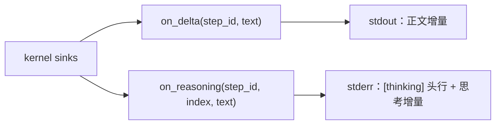

# Chat streaming shell：`chat --stream`

**定位**：`minihns chat` 的终端 shell 适配器，不新增内核流式路径。

**图索引**：图 1 两条 sink 的终端分流（§1）。

**一句话**：chat 只是 kernel sink 的终端适配器——正文走 stdout、思考走 stderr，delta 不落日志。

## 1. 形状

**图 1**：两条 sink 分开，互不混流；delta 不落日志，`--no-stream` 回退到轮末整段投影。

- 默认 `--stream`；`--no-stream` 显式回到旧的整段日志投影。
- 正文只写 stdout；思考只写 stderr，不混进正文。
- 有 delta 的轮结束后不再打印最终整段；没有 delta 时回退到 `model/response` 投影。
- Ctrl-C 仍按轮取消；已写出的前缀不撤回，不补最终整段。
- 日志仍只有 durable 事件；delta 不落日志。

## 2. 与 Host SSE 的区别

Host 的 `reasoning/delta` / `model/delta` 走 SSE + 游标 + 重连；chat 是进程内终端，不需要
`id`、cursor、snapshot、`stream/end` 或重连。共享的抽象只到 kernel sink。

## 3. 不做什么

不做终端折叠 UI、不做 host SSE 改动、不做多客户端队列；这些属于壳。
