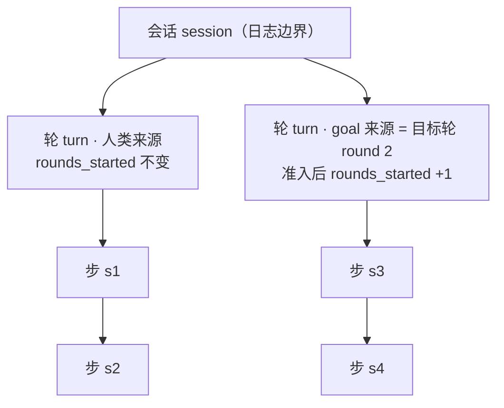
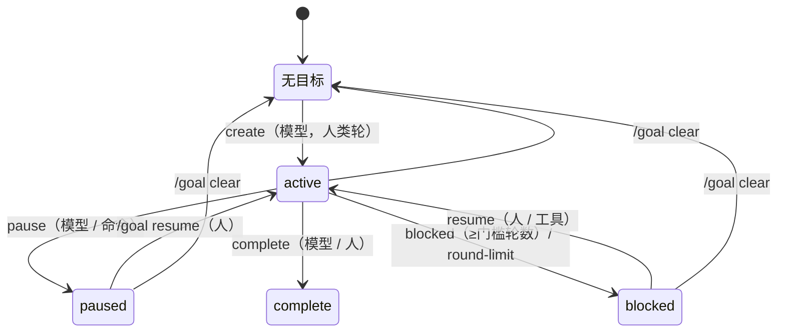
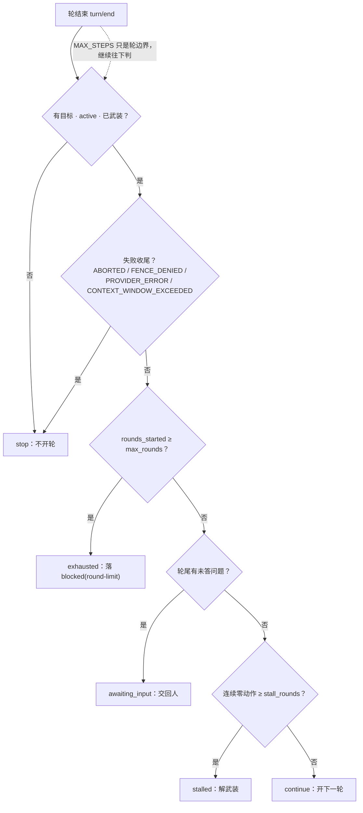

# 目标轮：状态、判定与收尾（M13 实现笔记）

**定位**：M13 的实现笔记，不是规格。**现状综合笔记**（政策 v3、打印规则、完整状态机）见
`docs/analysis-goal-core-mechanics-2026-11-27.md`。规格见 `openspec/changes/m13-goal-rounds/`（archive 后进 `openspec/specs/goal|turn-loop|event-stream|cli|host-api|config-layering`），验收证据见 `docs/verification/m13-goal-rounds-*.md`。本文回答三件事：**目标怎么活过多个轮**、**为什么拆成纯函数 / 判定器 / 执行器三层**、**哪些边界是故意留的**。

**一句话**：目标只活在日志的 `goal/updated` 里；`goals.py` 管「什么转移合法」，`goal_driver.py` 管「该不该再开一轮」，`turn_loop.py` 管「跑」，`settle_turn` 是三者唯一的接线处。

**图索引**：图 1 时间层级（§1.1）· 图 2 相位状态机（§1.3）· 图 3 轮后驱动判定（§2.2）。三张图与综合笔记 `docs/analysis-goal-core-mechanics-2026-11-27.md` 同源；那里的图 4（打印时序）不在本文重复。

**术语**：本文用 2026-11 改名后的词——一个**轮**（turn）是一条输入展开的那串步，一个**步**（step）是一次模型往返。2026-11 之前它们分别写作「段」与「回合」，旧文档与归档 change 保持原词。

---

## 1. 形状

### 1.1 四个时间词

| 层 | mini 现名 | DSH | 边界事件 | 数什么 |
|---|---|---|---|---|
| 会话 | session | session | `session/start` / `session/end` | 一整个日志 |
| 轮 | turn | turn | `turn/start` / `turn/end` | 一条输入展开的那串步 |
| 步 | step | step | `step/start` / `step/end` | 一次模型往返 + 这批工具 |
| 目标轮 | round | goal round | 没有独立事件，数 `goal/updated` 的 `source.round` | goal 消息被准入的次数 |

**目标轮不是第四层嵌套，而是轮的一种**：goal 来源的轮就是一次目标轮，人类的轮不是。所以「goal 轮恰是一次目标轮」成立；`rounds_started` 数的是这种轮，人类轮不计数。

**图 1**：目标轮与人类轮都各是一次 turn，区别只在 `user/message.source`；它不是第四层嵌套。



改名（`openspec/changes/align-turn-step-naming/`）已 apply：`segment → turn`、`turn → step`，日志 schema 升到 v2，v1 兼容层在合并前删除。读本文与读代码是同一套词。

### 1.2 事件

| 事件 | 载荷要点 | 谁写 | 用途 |
|---|---|---|---|
| `goal/updated` | `{goal: 快照}` 或 `{goal: null}` | 工具、命令、驱动 | 目标的**唯一**事实；整值快照，不是增量 |
| `user/message` | `{content, source}`；goal 来源带 `{kind: "goal", goal_id, revision, round}` | 轮入口 | 区分人话与自动轮；轮号在 `source.round` |
| `turn/end` | `{turn_id, stop_reason, steps, tool_calls}` | `turn_loop` | `tool_calls` 是停滞闸门的判据 |
| `question/asked` / `question/answered` | `{question_id, ...}` | `ask_user` | 未决问题只有「问了没答」这一条线索 |

goal 轮的轮首顺序（ADR-0043，2026-11-19 人裁）：

```
turn/start
  → goal 来源 user/message
  → 首条 step/start
  → 首条 context/assembled
  → goal/updated（rounds_started 递增）
  → model/request
```

额度在**首条 `context/assembled` 落盘之后**才计：装配之前失败（注入、折叠、压缩）不扣轮次。

### 1.3 状态

**持久层**（`GoalSnapshot`，只在 `goal/updated` 里）：

| 字段 | 含义 |
|---|---|
| `id` / `revision` | 目标身份与**定义版本号**（CAS 用） |
| `objective` | 目标正文；随时可 edit |
| `phase` | `active` / `paused` / `blocked` / `complete` |
| `max_rounds` | 单目标轮次上限；部署值（缺省 32）是硬顶 |
| `rounds_started` | 已准入的 goal 轮数（里程表） |
| `blocked_reason` | 仅 `blocked` 时存在：`{code, message}` |

**进程内层**（`GoalRuntime`，永不落盘）：

| 字段 | 含义 | 何时变 |
|---|---|---|
| `armed` | 要不要自动推进 | create / 人类 resume → 真；pause / complete / blocked / 额度用尽 / 失败收尾 / 停滞 → 假；启动与 `--resume` 后一律假 |
| `idle_rounds` | 连续多少个 goal 轮次零工具调用 | goal 轮无动作 +1，有动作清零；人类轮清零 |

`armed` 不落盘是刻意的：落盘会导致 `--resume` 之后意外自动跑。它是入口的进程内开关，不是目标的状态。

**图 2**：相位转移。`paused` 只有人能恢复；`blocked` 人与工具都能恢复；`complete` 是终点（只能 clear 回到无目标）。每次转移都伴随 `revision + 1`。



### 1.4 命令面

| 位置 | 命令 | 说明 |
|---|---|---|
| chat 提示符 / host `POST /commands` | `/goal` | 查看快照与武装位 |
| 同上 | `/goal pause` / `resume` / `complete` / `clear` | 无参数动词；带参数直接报用法 |
| 同上 | `/goal edit <新正文>`、`/goal <新正文>` | 只换 objective；相位与武装位不动 |
| CLI（离线） | `minihns goal <id> show\|edit\|clear` | `edit` 可带 `--max-rounds N`；**不做** pause/resume/complete |

分工的理由：`--flag` 是脚本接口，提示符是自然语言界面。运行期控制（pause/resume/complete）离线写会产生「没人按过」的动作，所以只留在会话内。

---

## 2. 机制

### 2.1 四个角色

```
cli/main.py (chat) ─┐
session/host.py ────┼→ settle_turn ─┬→ goal_driver.next_round   只判，不写
loop/turn_loop.py ──┘  （turn_loop） ├→ goals.fold_goal          读状态
   run_session_env                   └→ goals.exhaust/abort/pause 算新状态
                                            ↓
                                   EventLog.append("goal/updated")  唯一写点
```

- **`goals.py`：交通规则。** 纯函数，不碰 IO、不读时钟、不知道轮与工具。输入快照，输出新快照或 `GoalRefusal`；CAS、相位矩阵、阻塞门槛（`rounds_started` 至少跑满 3 轮）、`advance_round` 不递增 `revision`，都在这里。
- **`goal_driver.py`：红绿灯。** 输入快照 + `armed` + `stop_reason` + `question_pending` + `idle_rounds` + `stall_rounds`，输出五选一。不改状态、不写日志、不知道日志路径。
- **`turn_loop.py`：路和车。** `run_turn` 跑一轮并产出 `TurnOutcome(stop_reason, steps, tool_calls)`；轮尾调 `settle_turn`。它不做「该不该继续」的判断。
- **`settle_turn`：路口。** 读状态 → 维护计数 → 调驱动 → 需要落副作用时调纯函数并写 `goal/updated`。三个入口共用同一份，host 不再「只有命令面、没有驱动」。

**为什么拆四层**：纯函数可以单测每一种转移与每一种判定组合；日志是唯一事实源，`--resume` 与 `replay` 走同一条 `fold_goal`；多入口不分叉。代价是新增相位要同时改 `goals.py`（转移）与 `turn_loop.py`（收尾处置）。

### 2.2 一次轮收尾的五步

```
run_turn 返回 TurnOutcome
  → settle_turn
       ① goal_after(log) → fold_goal          读「现在」（状态折叠，不遮蔽）
       ② idle_rounds：goal 轮且 tool_calls==0 → +1，否则清零；人类轮清零
       ③ next_round(...)                      五选一
       ④ 按 decision 落副作用
       ⑤ 入口决定下一轮由谁触发
```

`next_round` 的判定顺序是固定的，**先硬后软**：

| 顺序 | 条件 | 结论 | 处置 |
|---|---|---|---|
| 1 | 无目标 / 非 `active` / 未武装 | `stop` | 不开轮 |
| 2 | `stop_reason ∈ {ABORTED, FENCE_DENIED, PROVIDER_ERROR, CONTEXT_WINDOW_EXCEEDED}` | `stop` | 解除武装；`ABORTED` 另把 `active` 置 `paused`，其余失败相位不动 |
| 2.5 | `stop_reason == MAX_STEPS` | 继续判 3–6 | **轮边界，不是失败**：写满本轮步数只结束这一轮；目标 `active` 且已武装时照常开下一轮（2026-11-25 人裁，`goal-round-pacing`） |
| 3 | `rounds_started >= max_rounds` | `exhausted` | 写 `blocked{round-limit}`，解除武装 |
| 4 | 轮尾有未决问题 | `awaiting_input` | 不开轮，保持 `active/armed`，交回控制权 |
| 5 | `stall_rounds > 0` 且是 goal 轮且 `idle_rounds >= stall_rounds` | `stalled` | 解除武装、相位不动、计数清零 |
| 6 | 其余 | `continue` | 开下一轮，`rounds_started + 1` |

顺序本身就是语义：额度用尽比未决问题更硬（最后一轮里问了问题也先落 blocker）；问题比空转更硬（先告诉人「等你回答」）。

**图 3**（判定顺序即优先级，先命中先返回；`MAX_STEPS` 不在这条判定里）：



### 2.3 人话、提问、恢复

**人话优先（D13，对齐 DSH 的 `competingQueued`）**

host 的 `submit_message` 在轮进行中把消息放进**深度 1** 的队列；轮收尾后先跑队首人话，队列空才开 goal 轮。人类轮 `goal_round=False`：不推进 `rounds_started`、不改 `phase`、不改 `revision`。队列里再有人话就继续先跑人话。粒度是**轮边界**，不做步之间插队——DSH 的排队消息也要等当前 turn 收尾才成为下一条 user 消息。

chat 没有轮中队列（同步 `readline`），提示符上的下一条输入同样先于自动轮次。这是本地调试入口的形态，不是语义缺失。

**提问（D15，取代 D11）**

- 轮内答上（tty / host 的 HTTP 等待窗口内）：同一轮继续，不新开轮。
- 答不上（`ask_user` 返回 `QUESTION_UNAVAILABLE`）：`session.questions.pending` 记下 id，轮尾驱动给 `awaiting_input`，**目标保持 `active/armed`**，回到提示符 / idle。
- 人的回答是一条**人类轮**（`source.kind == "user"`），不推进轮号；这轮收尾后驱动照常判定，下一 goal 轮是 `source.round == n + 1`。
- 未决问题是**轮作用域**：轮首清空，不跨轮继承。

所以「人回答后算不算新开一个 goal 轮」的答案是：**回答本身不算，回答之后的那一轮才算。**

**恢复（D12）**

`/goal resume` 把武装位从假翻到真之后，chat 与 host 都**立刻开下一轮**，不等客户端再 POST 一条。判定收在 `next_goal_round(env)`。目标已经 active 且武装时的 `/goal resume` 只回一句「无需 resume」，不能再起一轮——否则问题未决时敲习惯性命令会白烧额度。

### 2.4 完成与停止：谁能结束一个目标

| 谁能结束 | 怎么结束 | 强度 |
|---|---|---|
| 模型 | `update_goal complete`（需带对的 `id@revision`） | 声明；harness 无法验证 |
| 模型 | `update_goal blocked`（`rounds_started` 至少跑满 `blocked_after_consecutive_rounds`，缺省 3） | 声明 + 门槛 |
| 系统 | `rounds_started >= max_rounds` → `blocked{round-limit}` | 硬 |
| 系统 | 停滞闸门：连续 `stall_rounds`（缺省 2）轮零工具调用 | 半硬：只解武装，不改相位 |
| 系统 | 失败 / 取消 → 解除武装；`ABORTED` 另落 `paused` | 硬 |
| 系统 | 未决问题 → 交回控制权，不结束目标 | 软 |
| 人 | `/goal pause` / `complete` / `clear` / `edit`；CLI 离线 `edit` | 硬 |

**完成只能由模型声明**，因为完成是「工作区里的目标是否达成」的事实，harness 没有可读证据。替模型写 `complete` 会让 `replay` 里出现一条没人做过的声明。能加的是**反面证据**：一轮里一个成功派发的工具调用都没有，说明这一轮没推进。

**停滞闸门（D14）**：`[goal] stall_rounds` 缺省 `2`，`0` 关闭（完全对齐 DSH）。

- 判据单位是**轮**（一次准入），不是步：一轮里只要有一个工具调用就不算空转。
- 阈值取 1 会误杀「读文件后判断没新内容」的研究型轮次；取 3 以上白烧额度。
- 处置只解武装、不改相位、不落事件：`armed` 是「要不要自动推进」的进程内开关，`phase` 是目标本身的状态；「空转」不该被写成「人叫停」。
- 残余：模型每轮读一个文件再说「没有新内容」时 `tool_calls > 0`，闸门不触发。更强判据（工作区指纹 / 每轮必须更新 todo）会误杀研究型轮次，不做。

**与主流 harness 的对照**：

| 系统 | 完成判据 | 空转处理 | 预算 |
|---|---|---|---|
| DSH | 模型 `complete` / `blocked` / `max_rounds` | 无 | 轮次硬上限 |
| Claude Code `/goal` | 每轮由独立小模型判 `met / not yet met / impossible` | 有 stall detection：连续几轮不用工具才停，**保留 goal**，下次人类提示后恢复 | 条件里可写「跑满 20 轮就停」 |
| Codex goal mode | 结构化 `update_goal`（pursuing/paused/achieved/unmet/budget_limited） | Ralph loop 的 Review 阶段 | token 预算**建议性**：命中后注入 wrap-up，不硬杀 |
| mini | 模型声明 + 硬上限 + 停滞闸门 + 人的命令 | 连续 2 轮零动作 → 解武装 | `max_rounds` 硬顶（缺省 32） |

三家都没有「保证语义完成」这回事：最终闸门在 harness（轮次 / 预算 / 阻塞次数），完成声明在模型。所以在 DSH 里遇到「问题解决了但 goal UI 还是 active」是**结构性正常**，不是 bug——模型没调 `update_goal complete`。

### 2.5 工具面的人类轮约束

`create_goal` / `update_goal edit|pause|resume` 要求 `context.human_driven`：只有人类开口的轮能建目标、改定义、暂停、恢复；子会话与 goal 轮次里都会被 `GOAL_AUTHORITY_REQUIRED` 拒。`update_goal complete|blocked` 是模型在 goal 轮次里自己收尾的口子，不受这条约束。`get_goal` 任何轮都能读。

---

## 3. 两个折叠：同名不同物

这是最容易混的一处。mini 里有两个 `fold`：

| | 状态折叠（`fold_goal`） | 上下文折叠（`events/fold.py::fold`） |
|---|---|---|
| 输入 | 全部事件 | 全部事件 |
| 输出 | 一个 `GoalSnapshot` | 一串 `Message` |
| 消费者 | **驱动、命令面、UI** | **模型** |
| 会不会遮蔽 | 不会，一个字段都不删 | 会，但只**遵守**日志里已声明的遮蔽 |
| 目的 | 回答「现在是什么状态」 | 回答「模型该看到什么」 |

`goal_after(log)` 是第一种：`read_events` 全量读 → `fold_goal` 从头扫、只挑 `goal/updated`、每条覆盖 `current` → 最后一条即当前状态；`{"goal": null}` 表示清除。它服务的是**驱动判定**，不是模型上下文。

**遮蔽不发生在任何折叠里**，而是压缩动作写进日志的一条声明：`compaction/summary.shadowed_range` 说「第 100–180 条不再进上下文」。日志一条不删；`projection_states` 把每个 `seq` 标成 `in_context` / `shadowed` / `log_only`。折叠只是遵守这个声明。

**为什么全量重读，而不是读最后一行**：`goal/updated` 是整值快照，所以「最后一条 = 现在」成立；`{goal: null}` 是显式清除，不能跳过；每条 payload 过 `model_validate`，中间坏一条会在折叠时暴露；`--resume` 与 `replay` 走同一条路径。代价是每轮收尾 O(事件数)，长会话累计 O(n²)；当前规模可接受，不做内存缓存（缓存会引入多写入点的一致性问题）。

---

## 4. `revision` 与 `rounds_started`

一句话：**`revision` 是「第几版目标」，`rounds_started` 是「跑到第几轮」。**

| | `revision` | `rounds_started` |
|---|---|---|
| 语义 | 目标定义的版本号 | 已准入的 goal 轮数 |
| 何时变 | create / pause / resume / complete / blocked / abort / exhaust / edit / clear | 每次 goal 消息在 `context/assembled` 之后被准入 |
| 变多少 | `+1` | `+1`（`advance_round`） |
| 参与 CAS | 是：`update_goal` 带 `id@revision`，不符返回 `GOAL_REF_STALE` | 否 |
| 用途 | 防「拿旧目标改新状态」 | 额度、审计、`Round: n/cap` |

**为什么轮次推进不递增 `revision`**：如果每轮都 +1，模型在第一轮拿到的引用在第二轮就过期，`update_goal` 会莫名失败。DSH 的 `roundsStarted` 也是派生值，不是一次 goal 变更。

**中途 edit 的影响**：正在跑的轮不变（`GoalRound` 快照已冻结，`<goal_round>` 里是旧正文）；下一轮驱动重读日志，用新正文/新上限，`rounds_started` 继续、`revision + 1`、相位与武装位不动。两个坑：`--max-rounds` 调到 ≤ 已用轮数时下一轮直接 `exhausted`；正在跑的模型拿旧 `revision` 调 `update_goal complete` 会被 CAS 拒。

---

## 5. 决策与依据

| 决策 | 结论 | 理由 | 记录 |
|---|---|---|---|
| 轮次准入点 | 首条 `context/assembled` 之后 | 装配成功才算一轮，注入/折叠/压缩失败不白烧额度 | ADR-0043 |
| 单目标 | 同时只有一个未完成目标 | 对齐 DSH 的 current goal；任务并行靠 todo 多 `in_progress` | ADR-0042 |
| 人话优先 | 队列非空不开 goal 轮 | 对齐 `competingQueued`；粒度是轮边界 | design D13 |
| 问不到人 | 保持 `active/armed`，交回控制权 | 「等人」不是「暂停」；回答是人类轮 | design D15（取代 D11） |
| resume 即驱 | 命令成功立刻开下一轮 | 否则人要再敲一行，那行会开人类轮、把活干在轮次外 | design D12 |
| 停滞闸门 | 缺省开、阈值 2；`0` 关闭 | 1 轮误杀研究型轮次，3 轮白烧额度 | design D14 |
| 命令面 flag | 会话内无 flag，上限编辑归 CLI | flag 是脚本接口，提示符是自然语言界面 | 2026-11-23 人裁 |
| 上限硬顶 | `create` / `edit` 请求超过部署值按部署值落 | 模型不能用大数字绕开预算 | design D15 |

---

## 6. 边界与已知缺口

- **chat 没有轮中队列**：同步 `readline`，Ctrl-C 是唯一中断手段；host 才是通用入口。这不是语义缺失。
- **host 队列深度 1**：轮进行中只能再排一条；第三条被拒。够用，但不是无界队列。
- **完成不可验证**：只有模型声明；停滞闸门只抓「零动作」，抓不到「读了文件但没推进」。
- **未决问题没有持久记录**：不落 `paused`，日志里只有 `question/asked` 没有配对的 `question/answered`。人能读，但审计要自己配对。
- **`fold_goal` 全量重读**：每轮 O(n)，长会话 O(n²)。要优化可加「最后一条 goal 事件的 seq 索引」或从文件尾倒读，不能改成内存缓存优先。
- **目标表不跨轮**：`todos` 在轮首清空，goal 轮同样清（DSH 的 round 就是一次 turn）；跨轮靠模型历史与目标，不靠表（D8）。
- **`blocked_after_consecutive_rounds` 名不副实**：字段名说「连续」，实现与规格数的是 `rounds_started` **总轮数**（至少跑满 N 轮才允许报阻塞），不是「同一阻碍连续 N 轮」。要真按阻碍内容判重，得再加一份状态；现在没做。

---

## 7. 出处

- `src/mini_harness/goals.py`：`GoalSnapshot` / `GoalRuntime` / `fold_goal` / 相位纯函数 / `advance_round`
- `src/mini_harness/loop/goal_driver.py`：`next_round` 五选一
- `src/mini_harness/loop/turn_loop.py`：`run_turn`、`settle_turn`、`next_goal_round`、`close_failed_round`
- `src/mini_harness/tools/goal.py`：`get_goal` / `create_goal` / `update_goal`（CAS 与人类轮约束）
- `src/mini_harness/tools/assistant.py`：`ask_user` 与 `questions.pending`
- `src/mini_harness/commands.py`：`/goal` 命令面
- `src/mini_harness/cli/main.py`、`session/host.py`：两个入口的轮循环与 `/goal resume` 即时驱动
- `openspec/changes/m13-goal-rounds/`：proposal、design D1–D15、六份 delta 规格、tasks
- `docs/verification/m13-goal-rounds-dsh-review.md`：逐条对齐与偏离记账（D.9 为 2026-11-20 补裁）
- `docs/verification/m13-goal-rounds-host-driver.md`：host 驱动与队列的追加验收
- DSH 一手：`docs/dsh-reference/DSH运行时架构剖析.html`（图 7-1 驱动条件、协作型工具）、`goal.md:119`、`driver README:12`、`todo_index.ts:130`
