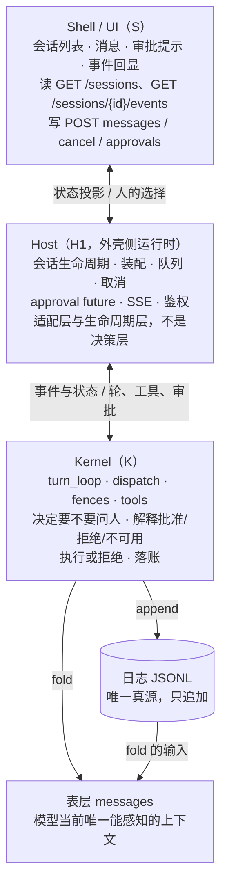
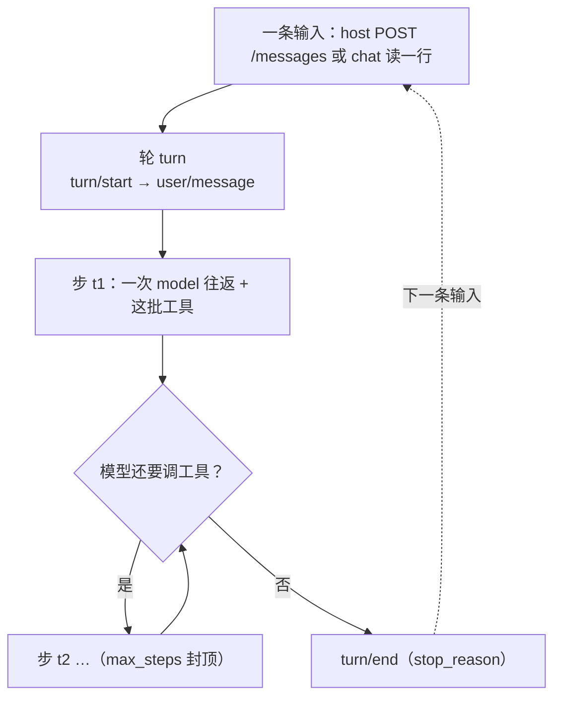
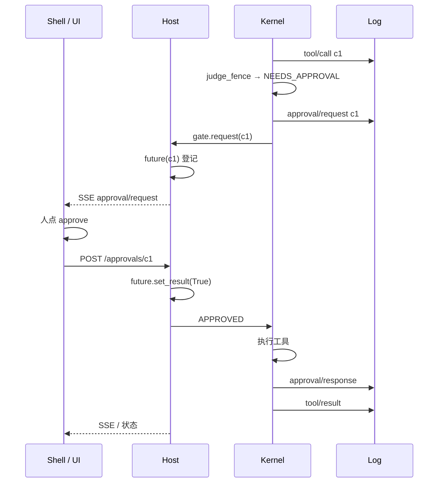
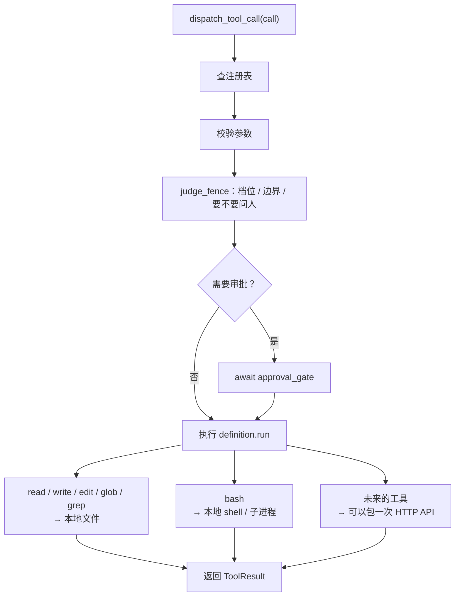
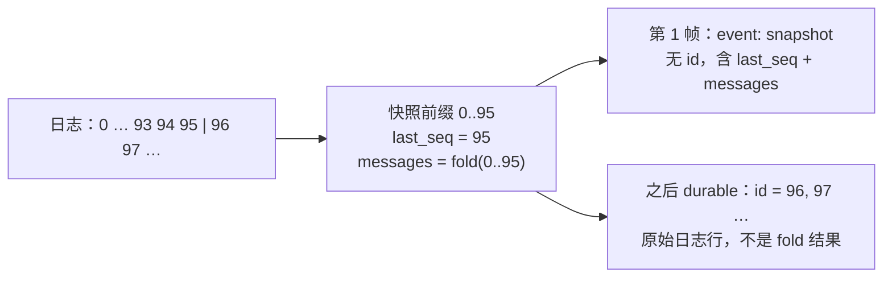

# 四层、轮与步、控制面

**用途**：把 H1 之后反复出现的一组概念讲成一条线——日志、表层、状态层，以及 Shell / Host / Kernel / Log 四层的职责。读完之后应该能回答：

- 一帧到底是什么，和「一步」是不是一回事；
- 轮和步怎么起、怎么停，`max_steps` 数的是什么；
- 审批从壳到内核再回到日志，中间谁决定、谁执行、谁记录；
- snapshot 为什么是「前缀折叠」，`last_seq` 之后又是什么；
- `dispatch` 到底做几件事，并发发生在哪一层。

这不是新架构，也不是 DSH 的 L0–L13 层号表；它是 mini 在 H1 这个时间点上的**运行时教学模型**。DSH 的 K/R/S 术语见 `GLOSSARY.md`。

**图索引**：图 1 四层总图（§0）· 图 2 轮与步的时间层级（§5）· 图 3 审批的跨层时序（§6）· 图 4 每次工具调用的 dispatch 管线（§7）· 图 5 snapshot 的前缀折叠与后缀续读（§8）。五张图用 Mermaid 写在正文；事件序列与数据形状仍保留代码块（替换会丢精度）。

**一句话**：日志是唯一真源，表层是它的前缀折叠，状态层是壳的投影；四层职责是「Shell 给选择、Host 做会话与传输、Kernel 做判断执行记账、Log 记住一切」。

---

## 0. 先看总图



**图 1**：四层职责与两份投影——日志是事实，表层是 `fold(日志前缀)`，状态层是壳的投影；Shell / Host / Kernel / Log 是处理这些投影与决策的四层。

从下往上看：

1. **日志**是事实；
2. **表层**是 `fold(日志前缀)` 给模型的投影；
3. **状态层**是壳从日志/运行时投影出来给人看的东西；
4. **Shell / Host / Kernel / Log** 是处理这些投影与决策的四层职责。

---

## 1. 日志：一帧 = 一条记录，不是一步

日志是只追加的 JSONL，唯一真源。每条记录都有 `schema_version` / `type` / `session_id` / `seq` / `ts` / `payload`。

```text
日志（按 seq 线性）
seq 0   session/start          ← 入口、workspace、工具表、平台事实
seq 1   turn/start             ┐
seq 2   user/message           │ 一个轮 s1
seq 3   step/start             ┐
seq 4   context/assembled      │ 一步 t1
seq 5   model/request          │
seq 6   model/response         │ 正文 + tool_calls=[c1]
seq 7   tool/call c1           │
seq 8   tool/result c1         │
seq 9   step/end               ┘
seq 10  turn/end               ┘
seq 11  turn/start             ← 下一轮
...
seq 20  compaction/summary     ← 声明遮蔽范围
...
```

要点：

- **一帧 = 一条 durable 记录**。SSE 上就是 `id=seq`、`event=type`、`data=整行 JSON`。唯一的例外是 `snapshot=1` 时先发的合成 `snapshot` 帧：它没有 `id`，不是日志记录（见第 8 节）。
- 一个 **步**由多帧组成：`step/start`、`context/assembled`、`model/request`、`model/response`、工具调用/结果、`step/end`。
- 一个 **轮**由多个步组成：`turn/start` → 若干步 → `turn/end`。
- 所以「一帧是一次工具调用或一次思考」不成立。工具调用至少跨 `model/response`（声明 `tool_calls`）、`tool/call`、`tool/result` 三条记录。

### 1.1 哪些记录会变成消息

| 日志记录 | 进表层吗 | 说明 |
|---|---|---|
| `session/start` | 特殊 | 派生受保护头部；`run` 的 prompt 另变一条 user |
| `turn/start` / `turn/end` | 否 | 轮边界，结构事实 |
| `step/start` / `step/end` | 否 | 步边界，结构事实 |
| `context/assembled` | 否 | 这次装配的审计快照，不是输入 |
| `model/request` | 否 | 请求记账 |
| `model/response` | 是 | assistant 消息（正文 + `tool_calls`） |
| `tool/call` | 否 | 日志里的调用台账，用于配对/闭合 |
| `tool/result` | 是 | tool 消息（按 `tool_call_id` 配对） |
| `user/message` | 是 | user 消息 |
| `approval/request` / `approval/response` | 否 | 控制面事实 |
| `error/*` | 否 | 失败事实 |
| `compaction/summary` | 是（system） | 摘要消息；同时声明遮蔽范围 |

---

## 2. 表层：fold 出来的「模型上下文」

`fold(records)` 是纯函数：不截断、不新造遮蔽、不自己摘要。它把日志前缀投影成 `AssembledContext.messages`。

```text
fold(records 0..N)
┌──────────────────────────────────────────────────────────────┐
│ messages[0]  system   受保护头部                              │
│              ← SYSTEM_PROMPT + 工具名 + 运行环境 + 追加段      │
│                                                              │
│ messages[1]  user     第一条 user/message（或 run 的 prompt） │
│ messages[2]  system   compaction summary（若有；插在第一条   │
│                       user 之后，否则紧随头部）               │
│ messages[3]  assistant model/response 的正文 + tool_calls     │
│ messages[4]  tool     tool/result 的内容（按 tool_call_id 配对）│
│ ...                                                          │
└──────────────────────────────────────────────────────────────┘
```

### 2.1 受保护头部

头部不是日志里的一条记录，而是从 `session/start.payload` 派生：

```text
SYSTEM_PROMPT
+ 可用工具名（session/start.tools）
+ 运行环境（platform）
+ 追加段（append_system_prompt）
```

它不可被遮蔽；`session/start` 永远在 fold 的输入里。

### 2.2 工具往返：表层里两条，日志里三条

```text
model/response
  assistant.tool_calls = [c1]          ← 表层里的 assistant 消息
        │
tool/call c1                           ← 只在日志里，不进 messages
        │
tool/result c1                         ← 表层里的 tool 消息
```

- `assistant.tool_calls`（字段）在表层；
- `tool/call`（事件类型）不在表层；
- 工具返回后，表层保留的是 **assistant.tool_calls + tool 消息**，不是「只剩 result」。模型协议要求二者成对。
- 如果日志切在 `tool/call` 之后、`tool/result` 之前，fold 会补一条读方派生的 `tool` 消息，内容 `TOOL_OUTCOME_UNKNOWN`（closer）；它不在日志里。

### 2.3 遮蔽：折叠的一条排除规则，不是折叠本身

```text
日志：
  seq 2..8   旧消息 / 工具往返          ← 仍在 JSONL，不删除
  seq 20     compaction/summary
             payload.shadowed_range = {start: 2, end: 8}

fold：
  seq 2..8  ──► 跳过，不产出 messages
  seq 20    ──► 一条 summary system 消息
```

必须区分：

- **折叠**：日志 → 表层的整体投影，包含头部派生、消息映射、工具配对、闭合、摘要插入；
- **遮蔽**：`compaction/summary` 声明的一段 seq 不再进对话体；它是折叠的一个输入；
- **没进 messages ≠ 被遮蔽**：`turn/start`、`tool/call`、`approval/*` 本来就不产消息；`model/response(purpose=compaction)` 是内部调用；这些都不是遮蔽；
- 被遮蔽的记录仍在日志里；durable 帧从 0 读仍会看到，只是 fold 不把它变成消息。

---

## 3. 状态层：壳看到的东西，不是第二真源

```text
状态层（壳的投影）
├─ GET /sessions           会话列表：status / workspace / last_seq / turns
├─ GET /sessions/{id}      单会话状态
├─ GET /events             durable 帧流（含内部记录）
├─ approval/request        UI 弹审批
├─ approval/response       UI 显示结果
└─ 会话的 conversation view：用户消息、模型回复、工具结果、审批提示
```

- 状态层不是新的持久化真源：H1 的 `HostState` 是内存会话表，进程重启就没了（M11 的 session index 再补）。
- SSE 的 durable 帧是**日志逐行镜像**，包含 UI 通常不显示的 `step/*`、`turn/*`、`tool/call`、`context/assembled`；UI 自己决定显示哪些。
- 用户看到的「对话」是状态层的一个子集；模型看到的「上下文」是表层。两者不是同一份东西。

---

## 4. 四层职责：Shell / Host / Kernel / Log

这里的 **Host** 是 H1 的宿主服务，归属外壳侧的运行时；单列是为了讲清控制面，不是把它算作内核。

| 层 | 拥有 | 不拥有 |
|---|---|---|
| **Shell / UI** | 人的选择（`approve` / `deny`）、审批提示、事件显示、会话操作 | 解释枚举、执行工具、写日志、fence 判定 |
| **Host** | 会话注册表/生命周期、装配、队列、取消、approval future 桥、SSE、鉴权/来源/上限、退出收尾 | fence 判定、工具执行、`approval/response`/`tool/result` 落账、枚举语义 |
| **Kernel** | `judge_fence`、`dispatch`、枚举解释、工具执行/拒绝、`turn_loop` 落账、停止理由 | UI、HTTP、人工选择 |
| **Log** | 所有 durable 事实：消息、工具、审批、错误、轮/步边界 | 产生决策 |

一句话：

> **Shell 给选择；Host 做会话与传输；Kernel 做判断、执行和记账；Log 记住一切。**

---

## 5. 轮与步：两个时间单位

**图 2**：轮由步组成，步是一次模型往返加这批工具；`max_steps` 数的是模型往返次数，不是工具调用数。目标轮只是轮的一种来源（§5.3），时间单位没有多一层。



### 5.1 轮：一条输入展开的那串步

```text
host / chat 入口
  POST /messages 或读一行
        │
        ▼
turn/start     (s1)
user/message
  turn t1 ──► model + tools
  turn t2 ──► model + tools
  ...
turn/end       (stop_reason)
```

- `chat` / `host` 的轮由一条 `user/message` 开启；`run` / `serve` 的 prompt 在 `session/start` 里，也照样是一轮。
- **host 的 `POST /messages` 只返回 202**（已接收或已排队），不返回最终结果；最终结果在 `turn/end`、`tool/result`、`model/response` 与会话状态里，客户端通过 SSE/状态观察。
- 队列里每条消息各自开一个新轮；同一会话同一时刻只有一个轮在跑。
- 轮可能提前结束：`MODEL_COMPLETED`、`ABORTED`、`FENCE_DENIED`、`CONTEXT_WINDOW_EXCEEDED`、`MAX_STEPS`、`PROVIDER_ERROR`。

### 5.2 步：一次 model 往返 + 这批工具

```text
一个 turn
├─ model/request
├─ model/response        ← 一次模型回复；可能带 tool_calls
├─ tool/call ×N
├─ tool/result ×N
└─ turn/end

下一个 turn 的 model/request 会看到上一批 tool/result
```

- **一步 = 一次模型请求/响应 + 响应里声明的工具批次**。
- 同一步多个工具：只读/网络类最多 8 个并行；会改动/独占类串行（M10 会把 `parallel` / `exclusive` + barrier 立成正式策略）。
- **一轮有多少步**由模型是否继续调工具决定，并由 `max_steps` 封顶；`max_steps` 数的是模型往返次数，不是工具调用数。
- 一步可以有很多工具调用，但仍只算一步。

### 5.3 目标轮：goal 来源的轮（M13 起）

同一套「轮」上多了一种来源：驱动在轮收尾后注入 goal 消息，开的仍是轮，只是它**恰好是一次目标轮**。所以时间单位没有增加一层——目标轮是轮的子集，`rounds_started` 数的是这种轮，人类轮不计数。目标状态、判定顺序、队列与提问交给谁，见 [`goal-rounds.md`](goal-rounds.md)。

---

## 6. 控制面：审批、取消、生命周期

控制面不是单独一层，而是一条**跨 Shell / Host / Kernel / Log** 的端到端路径。以审批为例：



**图 3**：审批是一条跨 Shell / Host / Kernel / Log 的端到端路径。Host 只翻译与同步，Kernel 解释枚举并执行或拒绝，四条 durable 记录（`tool/call`、`approval/request`、`approval/response`、`tool/result`）都落在日志里。

### 6.1 谁解释枚举

```text
approval_gate.request(c1) 返回：
  APPROVED    → dispatch 执行工具 → tool/result = OK
  DENIED      → 不执行 → tool/result = DENIED_BY_APPROVAL
                error/fence.code = APPROVAL_DENIED
  UNAVAILABLE → 不执行 → tool/result = DENIED_BY_APPROVAL
                error/fence.code = APPROVAL_UNAVAILABLE
拒绝的两路（DENIED / UNAVAILABLE）让轮以 FENCE_DENIED 收尾（只停轮，不结束会话）；APPROVED 继续执行
```

- **Kernel 拥有运行时解释权**：它决定是否需要审批、每个枚举值对应执行还是拒绝；
- 枚举含义由 `fences` spec 固定，Kernel 不能把 `DENIED` 解释成放行；
- **Shell 只能给 `approve` / `deny`**；H1 的 HTTP 不接受 `UNAVAILABLE`；
- **`UNAVAILABLE` 由 Host 的生命周期条件产生**：审批超时、取消、服务关停、重复登记；
- `approval: auto` 时不进审批门，`judge_fence` 直接放行，Shell 看不到 `approval/*`。

### 6.2 future 是异步信箱，不是「未来可扩展」

```python
future = loop.create_future()          # 空的占位
handle.approvals[call_id] = future     # 按 tool_call_id 登记
decision = await future                # 内核挂起，等壳回答

future.set_result(True)                # approve
future.set_result(False)               # deny
future.set_result(None)                # 超时/取消/关停 → UNAVAILABLE
```

- `asyncio.Future` 表示「一个现在还没有、以后会被填上的值」；
- 一次性：谁先 `set_result` 谁定结论；第二次对同一个 id POST 会 404；
- 它不是预留扩展点，是并发同步原语。

### 6.3 取消与退出

- `POST /cancel` 只结束当前轮：`error/abort`、`step/end(ABORTED)`、`turn/end(ABORTED)`，会话仍 `idle`；
- 队列不被清空；下一句照常开新轮；
- 服务退出：取消所有轮，等它们写完收尾记录，再为每个会话写 `session/end`，退出码 0。

---

## 7. 工具与 dispatch：每次调用的管线



**图 4**：`dispatch` 是每次工具调用的管线（校验 → 围栏 → 审批 → 执行 → 结果），并发不在这一层——同一批多个调用怎么并行是 `turn_loop` 的批处理策略。

- `dispatch` 是**每次工具调用的管线**：校验 → 围栏 → 审批 → 执行 → 结果；
- 具体是本地 shell 还是外部 API，由工具实现决定；`dispatch` 的形状不变；
- 当前内置工具只有文件工具和 `bash`，没有通用 HTTP 工具；
- **并发不在 dispatch 里**：同一批多个调用怎么并发，是 `turn_loop` 的批处理策略（只读并行、改动串行）；`dispatch` 只负责一条调用。

---

## 8. 快照：前缀折叠 + 后缀续读



**图 5**：snapshot 是前缀折叠，不是「最后一步的结果」。`last_seq` 是前缀终点而非起点；快照之后 durable 必须从 `last_seq + 1` 连续，缺一条才是 bug。

- snapshot 是**前缀折叠**：覆盖当时日志的 `0..last_seq`，不是「从 last_seq 到 EOF」的尾段；
- `last_seq` 是前缀终点，不是起点；之后从 `last_seq + 1` 送 durable 帧；
- snapshot 没有 `id`，客户端用 `snapshot.last_seq` 当新游标；
- 如果快照时任务还在跑，`status` 可以是 `running`，snapshot 之后继续送新记录；
- **93→95 不是丢帧**：94/95 已折进 `messages`，快照就是追赶；但 snapshot 之后的 durable 帧必须从 `last_seq+1` 连续，缺一条才是 bug。

---

## 9. 常见误解

| 误解 | 实际 |
|---|---|
| 一帧 = 一步/一个工具调用 | 一帧 = 一条日志记录；一步由多帧组成 |
| 折叠 = 遮蔽 | 折叠是投影；遮蔽是折叠的一条排除规则 |
| 没进 messages 就是被遮蔽 | 结构记录、内部调用本来就不产消息 |
| Host 决定批准/拒绝 | Host 只翻译与同步；Kernel 解释枚举并执行/拒绝 |
| Shell 能直接执行工具或写日志 | Shell 只给选项；执行与落账在 Kernel |
| future = 未来可扩展 | `asyncio.Future` 是一次性异步结果占位 |
| snapshot = 最后一步的结果 | snapshot 是当前前缀的折叠上下文 |
| snapshot 后可以任意跳号 | snapshot 吸收历史；之后 durable 必须从 `last_seq+1` 连续 |
| `write` = `edit` | `write` 整文件覆盖；`edit` 基于读到内容的 CAS，可能 `STALE_EDIT` |
| 轮结束 = 一定拿到模型答案 | 轮也可能以 `ABORTED` / `FENCE_DENIED` / `CONTEXT_WINDOW_EXCEEDED` 等结束 |

---

## 10. 代码地图

| 文件 | 责任 |
|---|---|
| `src/mini_harness/events/writer.py` | `EventLog`：只追加、`seq` 单点分配 |
| `src/mini_harness/events/fold.py` | `fold` / `shadowed_seqs` / 受保护头部 / closer |
| `src/mini_harness/events/reader.py` | `LogTail`：按 `seq` 增量读 |
| `src/mini_harness/loop/turn_loop.py` | 轮/步主循环、停止理由、`approval/*` 落账 |
| `src/mini_harness/tools/dispatch.py` | 每次工具调用：校验 → 围栏 → 审批 → 执行 |
| `src/mini_harness/tools/fences.py` | 两轴围栏、`ApprovalGate`、`ApprovalDecision` |
| `src/mini_harness/session/assembly.py` | 装配：配置/密钥/工具/设置 → `Prepared` |
| `src/mini_harness/session/host.py` | 会话表、队列、取消、`HostApprovalGate`、退出收尾 |
| `src/mini_harness/cli/host.py` | HTTP/SSE、鉴权、snapshot、approval 路由 |

规格与术语：

- H1 外部契约：`openspec/changes/h1-host-session-api/specs/host-api/spec.md`
- 入口与 payload：`openspec/changes/h1-host-session-api/specs/cli/spec.md`
- 审批门：`openspec/changes/h1-host-session-api/specs/fences/spec.md`
- 术语：`GLOSSARY.md`
- UAT 第五道门禁：`docs/adr/0025-uat-acceptance-is-a-gate.md`
