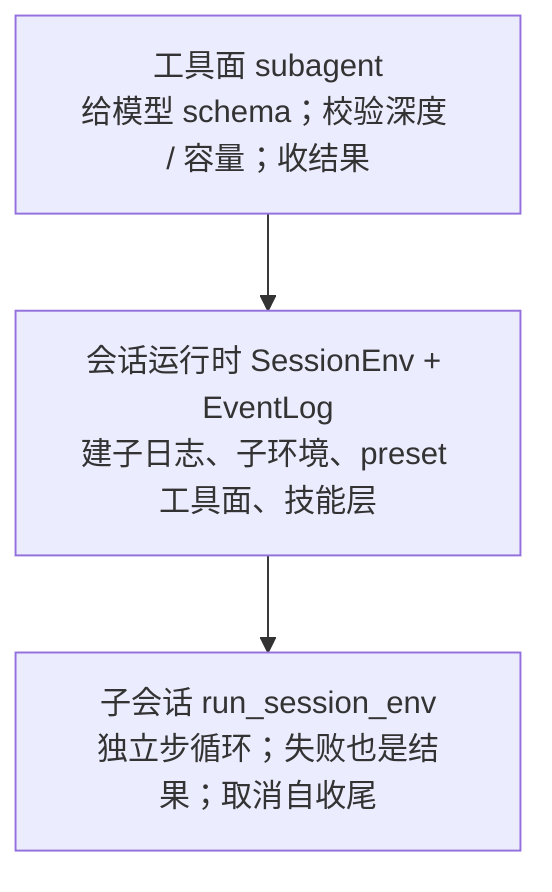
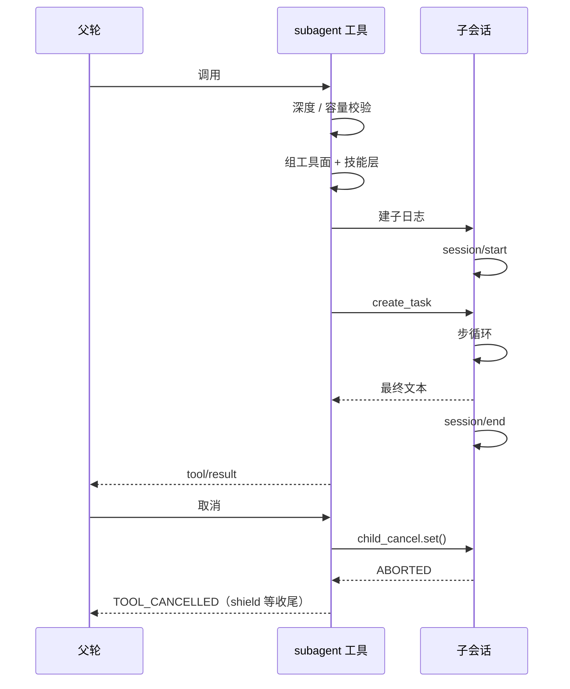

# 子代理：mini 的机制与取舍（M12 底稿）

**定位**：M12 的实现笔记，不是规格；已落成（`2026-11-09-m12-subagent-delegation`）。DSH 的完整设计面见 `docs/reference/dsh-subagent-design.md`，本文只收敛「mini 做了什么、为什么、边界在哪」。

**一句话**：委派只做一次性 `spawn`；父会话给任务与上限，子会话有独立日志与独立工具面，结果以最终文本回到父的工具结果里。

**图索引**：图 1 三层职责（§2.1）· 图 2 一次 spawn 的时序（§2.2）。

## 1. 形状

`subagent` 是普通工具，入参是任务文本与可选的 preset/persona；结果是一个 `ToolResult`：

- 成功：`OK`，正文是子会话的最终回答；
- 子会话建模失败：`TOOL_IO_FAILED`，不读成「成功但空正文」；
- 深度越界：`DEPTH_EXCEEDED`；
- 并发越界：`ACTIVATION_LIMIT_REACHED`。

子会话在磁盘上是**同目录的另一个日志文件**，不是父日志的嵌套段；父日志只留 `tool/call` 与 `tool/result`，以及子会话启动时写入的父子指针。

## 2. 机制

### 2.1 三层职责

**图 1**：三层职责。子会话在磁盘上是同目录的另一个日志文件，不是父日志的嵌套段。

### 2.2 一次 spawn 的时序

**图 2**：一次 spawn 的时序；取消时先置子取消位，再用 `shield` 等它按 `ABORTED` 收尾。

### 2.3 七个动作

1. 校验深度：`MAX_DEPTH = 1`，子代理不能再派子代理；
2. 校验容量：`MAX_ACTIVE_SUBAGENTS = 8`，按**父会话**计数，没有全局池；
3. 决定工具面：有 preset 就从部署预设编译好的注册表取，没有 preset 就继承父的当前组合；父模型不能在调用里临时裁剪；
4. 决定技能层：全局层 + preset 目录层，同名由近层胜出；
5. 建子日志与子环境：审批门固定为「问不到人」，沙箱档位只能收窄；
6. 运行子会话：父段取消时先置子取消位，再用 `shield` 等它按 `ABORTED` 收尾；
7. 收口：登记活跃数减一，返回最终文本或失败结果。

## 3. 决策与依据

| 决策 | 理由 | 记录 |
|---|---|---|
| 只做 spawn，不做 fork | fork 会复制上下文，成本与语义都更重；M12 只需要「派一件事」 | ADR-0035 |
| 上限按父会话计，不做全局池 | 单进程上界 4×8=32，先不引入第二套配额 | ADR-0036 |
| 子级审批门固定为不可用 | 子会话没有人坐在终端前，继承放行等于绕过人 | ADR-0036 |
| 子级沙箱只能收窄 | 放宽会绕过宿主的 `--allow-danger-full-access` 许可 | ADR-0036 |
| 工具面由部署 preset 决定 | 「子能有什么」不应由模型临场决定；preset 是部署侧配置 | ADR-0037 |
| 技能层用目录，同名近层胜出 | 与技能注册表的既有分层一致，避免再引入一套优先级 | ADR-0040 |

## 4. 边界与已知缺口

### 4.1 DSH 已实现、mini 未实现

- **fork 后端**：DSH 有 `subagent-fork-in-process`，从父的已完成历史起子会话；mini 明确不做（ADR-0035），只做空上下文 spawn。
- **进程外后端**：DSH 有 ACP、Codex app-server、Claude Code SDK、DSH SDK 四类；mini 只有进程内 spawn。
- **续跑与常驻**：DSH 的子会话可继续接收消息、可冷恢复；mini 一次执行、结束即返回。
- **控制面**：DSH 有 `send_message` / `interrupt_agent` / `list_agents`；mini 没有父到子的消息通道。
- **回报通道**：DSH 有 child-scoped `report`；mini 只有最终文本。
- **多 provider 并存**：DSH 允许一个上下文注册多个具名 provider；mini 只有一条 in-process 路径。

### 4.2 DSH 也未实现或明确不强制

- **report 只是提示，不是强制**：DSH 自己的说明写明「guidance, not enforcement」，子会话零次或多次调用都接受，没有运行路径会因为「从不汇报」拒绝它。
- **消息不能改写进行中的工作**：DSH 的控制消息按 FIFO 排到子会话的下一步；子会话正在跑的那一步不会被中途改向。
- **`list_agents` 有额外依赖**：它需要 session store 与 projection registry 才能读目录，不是纯工具。

### 4.3 mini 独有的简化代价

- 深度固定 1、并发固定 8，且并发按父会话计；
- 结果只有最终文本，产物清单与投递状态留给壳；
- 子会话与父共享工作区，没有 worktree 隔离；
- 子会话失败不重试。

## 5. 出处

- `src/mini_harness/tools/subagent.py`：深度、容量、preset、子环境与取消桥；
- `src/mini_harness/session/delegation.py`：`MAX_DEPTH` 与 `MAX_ACTIVE_SUBAGENTS`；
- `docs/adr/0035`、`0036`、`0037`、`0040`；
- DSH `packages/subagent/`（含 `subagent-fork-in-process`、`subagent-acp`、`subagent-codex`、`subagent-claude-code`、`tool-subagent-control`、`tool-subagent-report`），commit `47f9438`；
- `openspec/changes/archive/2026-11-09-m12-subagent-delegation/`。
